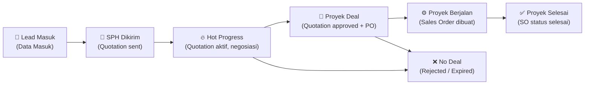

# 🏗️ Blueprint: Fitur Lead Pipeline — Q-Sales (ACTiV)

> Analisis desain & arsitektur teknis untuk fitur Lead Pipeline yang terintegrasi dengan sistem Quotation, PO, dan Sales Order yang sudah ada.

---

## 🔍 Analisis Referensi (Gambar)

| Halaman                 | Deskripsi Fungsi                                                                                                                                                                                     |
| ----------------------- | ---------------------------------------------------------------------------------------------------------------------------------------------------------------------------------------------------- |
| **Leads (Kanban)**      | Tampilan papan Kanban dengan kolom tahapan pipeline. Setiap "card" mewakili satu lead/prospek dengan nilai, nama kontak, waktu, dan progress status. Ada toggle antara view **List** dan **Kanban**. |
| **Pencapaian**          | Dashboard achievement sales. Dilengkapi visualisasi target vs. realisasi per bulan dan per project.                                                                                                  |
| **Visit & Follow-up**   | Jadwal kunjungan dan riwayat follow-up. Ada tab "Tabel" dan "Kalender". Check-in dan rekam meeting.                                                                                                  |
| **Generate Leads**      | Tool berbasis AI untuk menghasilkan prospek berdasarkan kriteria produk/industri.                                                                                                                    |
| **Pengaturan Pipeline** | Konfigurasi tahapan pipeline per tim, label normal/deal/lost, warna kolom.                                                                                                                           |

---

## 🔗 Bagaimana Lead Pipeline Berkesinambungan dengan Quotation, PO & SO



### Mapping Stage → Model Eksisting

| Stage Pipeline      | Status di Sistem                           | Model Terkait                             |
| ------------------- | ------------------------------------------ | ----------------------------------------- |
| **Data Masuk**      | Lead baru, belum ada penawaran             | `Lead` _(tabel baru)_                     |
| **SPH Terlayang**   | Quotation status `sent`                    | `Quotation` → `status = sent`             |
| **Hot Progress**    | Quotation masih aktif, negosiasi berlanjut | `Quotation` → `status = sent/created`     |
| **Proyek Deal**     | PO diterima, Quotation `approved`          | `Quotation` → `status = approved`         |
| **Proyek Berjalan** | Sales Order dibuat                         | `SalesOrder`                              |
| **Proyek Selesai**  | SO selesai/delivered                       | `SalesOrder` → `status = completed`       |
| **No Deal**         | Quotation `rejected/expired`               | `Quotation` → `status = rejected/expired` |

> [!IMPORTANT]
> **Integrasi dua arah**: Saat Quotation dibuat dari sebuah lead → Lead stage otomatis naik ke "SPH Terlayang". Saat Quotation di-_approve_ → Lead stage otomatis naik ke "Proyek Deal". Saat SO dibuat → Lead ke "Proyek Berjalan".

---

## 🗄️ Skema Database Baru

### Tabel: `leads`

```sql
id              UUID PK
lead_code       VARCHAR(20) UNIQUE  -- misal: L2611.001
title           VARCHAR(255)        -- nama project/kebutuhan
customer_id     FK customers.id (nullable, bisa lead baru blm jd customer)
customer_name   VARCHAR(255)        -- jika belum customer
customer_phone  VARCHAR(50)
customer_email  VARCHAR(255)
customer_address TEXT
pic_name        VARCHAR(255)        -- kontak person di customer
pic_phone       VARCHAR(50)
sales_id        FK users.id
bu_id           FK business_units.id
stage           ENUM: data_masuk | sph_terlayang | hot_progress | proyek_deal | proyek_berjalan | proyek_selesai | no_deal
source          VARCHAR(100)        -- referral, cold_call, website, generate_ai, dll
estimated_value DECIMAL(15,2)
quotation_id    FK quotations.id (nullable, terisi saat quote dibuat)
notes           TEXT
lost_reason     TEXT                -- diisi jika no_deal
tags            JSON
sort_order      INTEGER DEFAULT 0   -- urutan di kanban kolom
is_archived     BOOLEAN DEFAULT FALSE
created_by      FK users.id
updated_by      FK users.id
converted_at    TIMESTAMP (saat jadi customer/deal)
timestamps
```

### Tabel: `lead_activities`

```sql
id              UUID PK
lead_id         FK leads.id CASCADE
user_id         FK users.id
type            ENUM: note | call | email | visit | follow_up | stage_change | quotation_linked | deal_won | deal_lost
title           VARCHAR(255)
description     TEXT
scheduled_at    TIMESTAMP (untuk follow-up/visit terencana)
completed_at    TIMESTAMP
metadata        JSON (data tambahan, mis: quotation_id, old_stage → new_stage)
timestamps
```

### Tabel: `lead_visits` _(untuk Visit & Follow-up)_

```sql
id              UUID PK
lead_id         FK leads.id CASCADE
user_id         FK users.id (yang melakukan)
customer_id     FK customers.id (nullable)
visit_type      ENUM: visit | follow_up | meeting
subject         VARCHAR(255)
location        VARCHAR(255)
scheduled_at    TIMESTAMP
checked_in_at   TIMESTAMP (check-in saat kunjungan)
checked_in_lat  DECIMAL(10,7)
checked_in_lng  DECIMAL(10,7)
notes           TEXT
outcome         VARCHAR(255)
timestamps
```

---

## 🖥️ Halaman yang Akan Dibuat

### 1. `/leads` — Kanban & List View

**Fitur:**

- Toggle antara **Kanban** dan **List**
- **Kanban**: Kolom per stage, card bisa drag-and-drop antar kolom
- **List**: Tabel dengan filter, sort, pencarian
- Filter: Sales, Stage, Tanggal masuk, Nilai estimasi, Tags
- Header setiap kolom: nama stage, jumlah lead, total nilai estimasi
- Card lead: nama/title, customer, nilai estimasi, hari sejak masuk, quick-link ke Quotation/SO terkait
- Tombol **+ Tambah Lead** (modal)
- Badge stage warna sesuai

**Integrasi Quotation:**

- Dari card lead → tombol "Buat Quotation" → redirect ke `/quotations/create?lead_id=xxx` (prefill customer & pic)
- Quotation yang terhubung ditampilkan di card dengan status badge

### 2. `/leads/{id}` — Detail Lead

**Sections:**

- Header: Nama lead, stage badge, nilai, customer, sales, tombol aksi
- **Info Dasar**: Customer, PIC, source, tags, estimasi nilai
- **Timeline Aktivitas**: Riwayat semua aktivitas (note, call, stage change, dll)
- **Tambah Aktivitas**: Quick note/call/follow-up log
- **Quotation Terkait**: List semua quotation dari lead ini
- **Sales Order Terkait**: Jika sudah deal

### 3. `/leads/visits` — Visit & Follow-up _(Kalender nanti)_

**Fitur:**

- Tab: **Visit** | **Follow-up** | **Riwayat Check-in**
- View: **Tabel** | **Kalender** _(akan dibuat nanti)_
- Today's agenda: kunjungan hari ini
- Tambah jadwal visit/follow-up
- Check-in via tombol (simpan waktu + lokasi GPS optional)
- Rekam hasil meeting

### 4. (Opsional nanti) `/leads/generate` — Generate Lead AI

---

## 🎨 Design System (Warna Stage)

| Stage           | Warna        | Tailwind                          |
| --------------- | ------------ | --------------------------------- |
| Data Masuk      | Abu-abu      | `bg-surface-200 text-surface-600` |
| SPH Terlayang   | Biru         | `bg-blue-100 text-blue-700`       |
| Hot Progress    | Kuning-amber | `bg-amber-100 text-amber-700`     |
| Proyek Deal     | Brand/teal   | `bg-brand-100 text-brand-700`     |
| Proyek Berjalan | Ungu         | `bg-violet-100 text-violet-700`   |
| Proyek Selesai  | Hijau        | `bg-emerald-100 text-emerald-700` |
| No Deal         | Merah        | `bg-red-100 text-red-700`         |

---

## 📋 Rencana Implementasi (Urutan Pengerjaan)

### Phase 1 — Database & Backend

1. Migration `leads` + `lead_activities` + `lead_visits`
2. Model `Lead`, `LeadActivity`, `LeadVisit` dengan relasi ke `Customer`, `User`, `Quotation`, `SalesOrder`
3. `LeadController` (CRUD + stage update + filter)
4. Update `QuotationController` → auto-link lead saat create, auto-update stage
5. Route `/leads` + `/leads/{id}` + `/leads/{id}/stage` + `/leads/{id}/activities`

### Phase 2 — Frontend Kanban & List

1. Page `Leads.jsx` — dual-view Kanban + List
2. Komponen `LeadKanbanBoard.jsx` — kolom + cards + drag-drop
3. Komponen `LeadCard.jsx` — card per lead
4. Modal `LeadFormModal.jsx` — create/edit lead
5. Tambahkan entry "Lead Pipeline" ke Sidebar

### Phase 3 — Detail Lead

1. Page `LeadDetail.jsx`
2. Komponen `LeadTimeline.jsx` — riwayat aktivitas
3. Komponen `LeadActivityForm.jsx`

### Phase 4 — Visit & Follow-up

1. Page `LeadVisits.jsx` — list + tab
2. Modal tambah visit/follow-up
3. Tombol check-in
4. Kalender _(dikerjakan terpisah)_

---

## ❓ Keputusan yang Perlu Dikonfirmasi

1. **Drag-and-drop Kanban**: Apakah perlu? (butuh install library `@dnd-kit/core` atau `react-beautiful-dnd`)
2. **GPS Check-in**: Perlu fitur ambil lokasi otomatis saat visit?
3. **Konversi Lead → Customer**: Saat lead berhasil deal dan customer belum terdaftar, apakah otomatis buat customer baru?
4. **Permission**: Apakah lead pipeline hanya untuk role Sales/Presales, atau Manager juga bisa lihat semua?
5. **Notifikasi**: Apakah ada notifikasi jika lead tidak di-follow-up lebih dari X hari?
