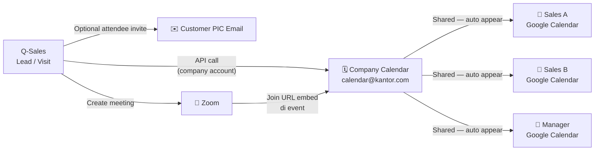

# 🗓️ Brainstorming: Google Calendar + Zoom Integration

> Q-Sales ACTiV — Lead & Visit Feature Extension

---

## 🎯 Visi Besar

**"Dari Lead ke Meeting ke Visit ke Deal — semua terhubung dalam satu ekosistem, tanpa buka aplikasi lain."**

Sales buat Visit di Q-Sales → otomatis masuk Google Calendar tim → kalau butuh meeting online → langsung generate Zoom link → selesai meeting → notes masuk ke Lead timeline.

---

## 🗺️ Arsitektur Overview — Shared Company Calendar

### Bagaimana Sistem Kalender Kamu Bekerja

```
📧 calendar@kantor.com (Company Gmail)
    └─ Punya Shared Calendar "Q-Sales Team"
         └─ Semua akun pribadi (@gmail.com / @kantor.com) di-invite sebagai Member
              └─ Setiap Sales sudah subscribe → event otomatis muncul di Google Calendar HP mereka

Q-Sales (sistem kita)
    └─ Connect ke calendar@kantor.com via Google Calendar API (OAuth sekali oleh Admin)
         └─ Saat buat Visit/Event → POST ke company calendar
              └─ Semua Sales langsung lihat di Google Calendar pribadi masing-masing ✅
```



**Keunggulan setup ini:**

- Admin cukup **setup 1x** (connect company Gmail ke Q-Sales Settings)
- Tidak perlu OAuth per-user — semua pakai company calendar
- Sales yang belum punya akun Google tetap bisa diinvite via email mereka
- Customer bisa dapat invite kalender langsung ke email mereka

---

## 📦 Module 1: Google Calendar Integration

### Konsep Utama — Satu Company Calendar, Semua Terhubung

| Siapa               | Akses                                                               |
| ------------------- | ------------------------------------------------------------------- |
| **Admin / Manager** | Lihat & edit semua event di company calendar                        |
| **Sales**           | Lihat semua event, hanya bisa edit event miliknya                   |
| **Customer PIC**    | Terima invite email (RSVP accept/decline), tidak punya akun Q-Sales |

### Event Types yang Di-sync

| Tipe Event        | Icon | Warna di Calendar  |
| ----------------- | ---- | ------------------ |
| Visit / Kunjungan | 📍   | Biru (`#4285F4`)   |
| Follow-up         | 🔁   | Amber (`#FBBC04`)  |
| Demo / Presentasi | 🖥️   | Hijau (`#34A853`)  |
| Meeting Internal  | 👥   | Ungu (`#9C27B0`)   |
| Instalasi         | 🔧   | Orange (`#FF6D00`) |
| Deadline PO       | ⏰   | Merah (`#EA4335`)  |
| Training          | 📚   | Teal (`#009680`)   |

### Setup Sekali oleh Admin (Settings → Integrasi)

```
Settings → Integrasi → Google Calendar
  └─ [Connect Google Account] → Login dengan calendar@kantor.com
       └─ Q-Sales simpan OAuth token (refresh token, long-lived)
            └─ Calendar ID company otomatis terdeteksi
                 └─ Admin bisa pilih calendar mana yang dipakai (jika ada beberapa)
```

Di tabel `system_settings` (sudah ada):

```json
{
    "google_calendar": {
        "connected": true,
        "company_email": "calendar@kantor.com",
        "calendar_id": "xxx@group.calendar.google.com",
        "access_token": "...",
        "refresh_token": "...",
        "token_expires_at": "2026-11-03T..."
    }
}
```

### Flow: Sales Buat Visit → Otomatis ke Company Calendar

```
Sales klik "+ Tambah Kunjungan"
  └─ Isi form: Lead, Jenis, Tanggal, Lokasi, Agenda
       └─ Toggle "Tambah ke Google Calendar" (default: ON)
            └─ Q-Sales POST event ke company calendar via API
                 ├─ Semua member calendar langsung lihat di HP masing-masing ✅
                 ├─ Sales yang buat → ditambah sebagai "organizer" (pakai email di profil Q-Sales)
                 └─ Customer PIC → ditambah sebagai "attendee" (opsional, jika ada email)
```

> [!TIP]
> Yang perlu disiapkan di profil User Q-Sales: field **"Email Google"** agar bisa di-tag sebagai organizer event. Bisa sama dengan email login, atau berbeda.

### Flow Admin: Company Calendar View

```
Admin buka halaman "Kalender Tim"
  └─ Google Calendar embed (iframe atau full API render)
       ├─ Semua event semua sales tampil (karena pakai company calendar)
       ├─ Color-coded by sales / event type
       └─ Klik event → buka Lead/Visit terkait di Q-Sales
```

### Fitur Unggulan Google Calendar

1. **Conflict Detection** — kalau Sales A sudah ada jadwal jam itu, sistem warning sebelum save
2. **Auto-Reminder** — 1 jam + 15 menit sebelum event, notif masuk ke app + email
3. **Customer Invite** — kalau ada email PIC di Lead, bisa auto-kirim Google Calendar invite ke customer
4. **Recurring Event** — untuk follow-up berkala (misal: "Follow-up ExxonMobil setiap 2 minggu")
5. **Location Link** — kalau ada alamat, auto-generate Google Maps link di event

---

## 📦 Module 2: Zoom Integration (Server-to-Server OAuth)

### Kenapa Server-to-Server (tidak OAuth biasa)?

|             | OAuth per User                     | Server-to-Server                             |
| ----------- | ---------------------------------- | -------------------------------------------- |
| Setup       | User login satu-satu               | Admin setup sekali, berlaku semua            |
| Token       | Expire, perlu refresh tiap user    | Long-lived, dikelola server                  |
| Lisensi     | Semua user pakai akun zoom sendiri | User dengan lisensi terdaftar di admin panel |
| Cocok untuk | App consumer                       | **Corporate / enterprise** ✅                |

### Konsep Lisensi di Q-Sales

```
Admin Settings → Integrasi Zoom
  └─ Tambahkan Zoom Account ID + Client ID + Client Secret (dari Zoom Marketplace)
       └─ Di User Management: centang "User ini punya lisensi Zoom"
            └─ Saat user buat meeting → sistem generate via account mereka
```

### Flow: Buat Zoom Meeting dari Lead/Visit

```
Di Lead Detail atau Form Visit:
  Klik "🎥 Jadwalkan Zoom Meeting"
    └─ Pop-up mini form:
         - Judul meeting (auto-fill dari Lead title)
         - Tanggal & Waktu
         - Durasi
         - Password meeting (opsional)
         - Host (default: user login, bisa ganti ke user lain yg punya lisensi)
    └─ Submit → API Zoom buat meeting
    └─ Hasil:
         ├─ Zoom link tersimpan di Visit/Lead
         ├─ Otomatis sync ke Google Calendar (deskripsi ada Zoom link)
         ├─ Notif ke peserta (internal + customer jika ada email)
         └─ Tampil di Lead Timeline: "📹 Zoom Meeting dijadwalkan"
```

### Zoom My Notes Integration

Setelah meeting selesai:

```
Zoom Meeting selesai
  └─ Host klik "End Meeting" → Zoom webhook trigger ke Q-Sales
       └─ Q-Sales terima:
            ├─ Recording URL (jika diaktifkan)
            ├─ Durasi actual meeting
            └─ Participant list
       └─ Tampil di Lead Timeline sebagai aktivitas
            └─ Sales bisa tambah "Meeting Notes" langsung dari timeline
                 └─ Tersimpan sebagai Lead Activity
```

---

## 🏗️ Arsitektur Teknis

### Backend (Laravel)

```
app/
├── Services/
│   ├── GoogleCalendarService.php    ← Google Calendar API wrapper
│   └── ZoomService.php              ← Zoom API Server-to-Server
├── Models/
│   ├── CalendarEvent.php            ← local cache event (gc_event_id)
│   └── ZoomMeeting.php              ← meeting record (zoom_id, join_url, etc.)
├── Http/Controllers/
│   ├── CalendarController.php       ← endpoint sync calendar
│   └── ZoomController.php           ← create meeting, webhook handler
└── Console/Commands/
    └── SyncCalendarEvents.php       ← scheduled sync jika API miss
```

### Database Tables Baru

```sql
-- Simpan referensi Google Calendar event
calendar_events
  id, model_type (visit/lead), model_id,
  gc_event_id, calendar_id, user_id,
  synced_at, created_at

-- Simpan Zoom meetings
zoom_meetings
  id, lead_id (nullable), visit_id (nullable),
  zoom_meeting_id, topic, join_url, password,
  host_user_id, scheduled_at, duration_minutes,
  status (scheduled/started/ended/cancelled),
  recording_url (nullable),
  created_at, updated_at
```

### Frontend: Halaman Kalender Tim (New Page)

```
/team-calendar

┌─────────────────────────────────────────────────────┐
│ 🗓️ Kalender Tim                    [+ Event Baru ▼] │
│                                                      │
│ Filter: [Semua Sales ▼] [Semua Tipe ▼] [Bulan ini ▼]│
│                                                      │
│ ┌─── Google Calendar Embed ──────────────────────┐  │
│ │                                                │  │
│ │  [Senin]    [Selasa]   [Rabu]   [Kamis]        │  │
│ │  📍Visit    🎥Zoom     🔁Follow  🖥️Demo         │  │
│ │  ExxonMobil  FWD Ins.  Pertamina BCA           │  │
│ │                                                │  │
│ └────────────────────────────────────────────────┘  │
│                                                      │
│ Upcoming (7 hari ke depan):                          │
│ ├─ Hari ini: 2 visit, 1 Zoom meeting                 │
│ ├─ Besok:    1 presentasi (ExxonMobil)               │
│ └─ Lusa:     Deadline PO FWD Insurance               │
└─────────────────────────────────────────────────────┘
```

---

## 🔗 Titik Integrasi di UI Existing

### 1. Form Tambah Visit (Existing → Enhanced)

```
Tambah Kunjungan
├─ Lead (dropdown)
├─ Jenis: [Kunjungan|Follow-up|Demo|Presentasi|...]
├─ Tanggal & Waktu
├─ Lokasi
├─ Agenda
│
├─ ──── Integrasi ────────────────────────────────
├─ [✓] Tambah ke Google Calendar
├─ [✓] Undang Customer (jika ada email PIC)
└─ [ ] Buat Zoom Meeting
         └─ (expand jika dicentang)
              Durasi: [60 menit ▼]
              Password: [auto-generate]
```

### 2. Lead Detail — Tab Activity (Enhanced)

```
📋 Timeline Lead
├─ 10:00 📍 Visit dijadwalkan → "Kunjungan site ExxonMobil"
│           [Google Calendar ✓] [📋 Lihat di Calendar]
├─ 10:05 🎥 Zoom Meeting dibuat → "Demo produk via Zoom"
│           [Join: zoom.us/j/xxx] [📋 Copy Link] [🔔 Reminder]
└─ 14:00 ✅ Visit selesai → "Check-in pukul 14:05 WIB"
             [+ Tambah Catatan Meeting]
```

### 3. Lead Detail — Tab Baru: "Meetings & Zoom"

```
📹 Meetings & Zoom
├─ [+ Jadwalkan Zoom Meeting]
│
│ Riwayat Zoom Meetings:
│ ┌─────────────────────────────────────────┐
│ │ 📹 Demo Produk UPVC               ✅ Selesai │
│ │    28 Okt 2026 · 14:00 · 45 menit        │
│ │    Host: Ahmad (Sales)                    │
│ │    [▶️ Recording] [📝 Notes]              │
│ └─────────────────────────────────────────┘
```

---

## 🚀 Roadmap Implementasi

### Phase 1 — Google Calendar (2-3 minggu)

- [ ] Setup Google Cloud Project + Calendar API credentials
- [ ] `GoogleCalendarService` — create/update/delete events
- [ ] Sync saat Visit disimpan (create/update/cancel)
- [ ] Halaman Settings: Connect Google Account (Admin)
- [ ] Company Calendar ID dikonfigurasi di Settings

### Phase 2 — Kalender Tim Page (1 minggu)

- [ ] Halaman `/team-calendar` dengan Google Calendar embed
- [ ] Filter by sales, event type, date range
- [ ] Upcoming events sidebar
- [ ] Conflict detection warning

### Phase 3 — Zoom Server-to-Server (2 minggu)

- [ ] Zoom Marketplace App (Server-to-Server type)
- [ ] `ZoomService` — create meeting, get recording
- [ ] User management: flag `has_zoom_license`
- [ ] Form tambah Zoom meeting dari Visit/Lead
- [ ] Zoom link tersimpan & tampil di Lead timeline

### Phase 4 — Zoom Webhook + Notes (1 minggu)

- [ ] Webhook endpoint: terima event `meeting.ended`
- [ ] Auto-update status meeting di DB
- [ ] Recording URL disimpan ke `zoom_meetings`
- [ ] Form "Meeting Notes" muncul setelah meeting berakhir

### Phase 5 — Notifikasi & Reminder (1 minggu)

- [ ] In-app notification 1 jam sebelum event
- [ ] Email reminder via Laravel scheduler
- [ ] Push notification (jika ada mobile app)

---

## ⚠️ Pertimbangan & Risiko

> [!IMPORTANT]
> **Google Calendar API** butuh OAuth credentials dari Google Cloud Console. Admin perlu connect akun Google perusahaan sekali di Settings. Semua event akan masuk calendar itu.

> [!IMPORTANT]
> **Zoom Server-to-Server** butuh akun Zoom with API access (Pro/Business plan). Buat app di [marketplace.zoom.us](https://marketplace.zoom.us) dengan type "Server-to-Server OAuth". Tidak perlu login per user.

> [!WARNING]
> Kalau user tidak punya lisensi Zoom, tetap bisa **join** meeting tapi tidak bisa **host** (buat meeting baru). Sistem harus handle ini gracefully — tampilkan pesan "Tidak ada lisensi Zoom, hubungi Admin."

> [!TIP]
> Untuk Company Calendar, lebih baik buat **dedicated Google account** (misal: `calendar@perusahaan.com`) yang di-share ke semua sales. Jadi tidak tergantung pada akun pribadi seseorang.

---

## 💡 Bonus Ideas

| Ide                      | Deskripsi                                                                     |
| ------------------------ | ----------------------------------------------------------------------------- |
| **Smart Scheduling**     | Saat buat Visit, sistem suggest waktu kosong berdasarkan calendar semua sales |
| **One-click Reschedule** | Kalau visit dibatalkan, bisa reschedule langsung update Google Calendar       |
| **Customer Portal**      | Invite customer via link, mereka bisa accept/decline tanpa punya akun Q-Sales |
| **Weekly Summary Email** | Setiap Senin pagi, semua sales dapat email "Jadwal minggu ini" otomatis       |
| **Mobile Sync**          | Event dari Q-Sales sync ke Google Calendar → otomatis masuk ke HP sales       |
