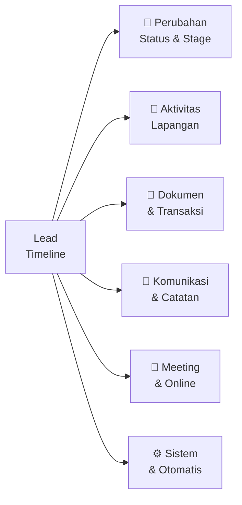

# 📋 Lead Timeline — Semua Aktivitas yang Bisa Direkam

> Q-Sales ACTiV — Lead 360° Cockpit

---

## 🗂️ Kategori Aktivitas



---

## 🔄 Kategori 1: Perubahan Status & Stage

| Aktivitas                   | Trigger                               | Data Tersimpan                                  |
| --------------------------- | ------------------------------------- | ----------------------------------------------- |
| **Lead Dibuat**             | Sales buat lead baru                  | Siapa yg buat, dari mana (manual/form/import)   |
| **Stage Berubah**           | Drag kanban / klik stage              | Dari → ke stage apa, siapa yang ubah, timestamp |
| **Lead Diassign**           | Manager assign ke Sales lain          | Dari siapa → ke siapa                           |
| **Customer Dihubungkan**    | Pilih customer existing / auto-create | Customer ID, nama                               |
| **PIC Ditambah / Diubah**   | Edit PIC di lead                      | Nama PIC, jabatan, kontak                       |
| **Deal Won** ✅             | Stage = `proyek_deal`                 | Nilai estimasi deal, tanggal close              |
| **Deal Lost** ❌            | Stage = `tidak_jadi`                  | Alasan kalah (dropdown + catatan)               |
| **Lead Dihidupkan Kembali** | Dari `tidak_jadi` → stage aktif       | Alasan re-open                                  |
| **Prioritas Diubah**        | High / Medium / Low                   | Nilai lama → baru                               |

---

## 👣 Kategori 2: Aktivitas Lapangan

| Aktivitas                 | Trigger                         | Data Tersimpan                                 |
| ------------------------- | ------------------------------- | ---------------------------------------------- |
| **Kunjungan Dijadwalkan** | Sales buat Visit                | Tanggal, lokasi, agenda, siapa yang pergi      |
| **Check-in Kunjungan**    | Sales tap "Simpan Lokasi"       | Koordinat GPS, waktu check-in, foto (opsional) |
| **Kunjungan Selesai**     | Melewati jadwal + check-in done | Durasi, catatan hasil kunjungan                |
| **Kunjungan Dibatalkan**  | Sales cancel visit              | Alasan pembatalan                              |
| **Follow-up Dijadwalkan** | Buat follow-up activity         | Tanggal, metode (telp/WA/email/tatap muka)     |
| **Follow-up Selesai**     | Tandai selesai                  | Hasil follow-up, next action                   |
| **Survey / Site Visit**   | Jenis visit = survey            | Catatan kondisi site, foto lapangan            |
| **Demo Produk**           | Jenis visit = demo              | Produk yang didemoin, feedback customer        |
| **Presentasi**            | Jenis visit = presentasi        | Peserta, deck yang dipakai, feedback           |
| **Instalasi**             | Jenis visit = instalasi         | Produk diinstall, teknisi, waktu selesai       |
| **Training**              | Jenis visit = training          | Materi, peserta, sertifikat                    |

---

## 📄 Kategori 3: Dokumen & Transaksi

| Aktivitas                  | Trigger                         | Data Tersimpan                           |
| -------------------------- | ------------------------------- | ---------------------------------------- |
| **Quotation Dibuat**       | Quot baru terhubung ke Lead     | Nomor quot, total nilai, sales yang buat |
| **Quotation Dikirim**      | Status quot → `sent`            | Tanggal kirim, ke siapa dikirim          |
| **Quotation Direvisi**     | Quot revision dibuat            | Nomor revisi, perubahan nilai            |
| **Quotation Disetujui**    | Status quot → approved          | Siapa yang approve, tanggal              |
| **Quotation Ditolak**      | Status quot → rejected          | Alasan penolakan                         |
| **PO Diterima**            | Upload / input PO dari customer | Nomor PO, nilai PO, tanggal PO           |
| **Sales Order Dibuat**     | SO terhubung ke lead            | Nomor SO, status                         |
| **Dokumen Diupload**       | Lampirkan file ke lead          | Nama file, tipe, siapa yang upload       |
| **Kontrak Ditandatangani** | Upload signed contract          | File kontrak, tanggal tanda tangan       |
| **Invoice Diterbitkan**    | (future) Inv terhubung          | Nomor invoice, jatuh tempo               |

---

## 💬 Kategori 4: Komunikasi & Catatan

| Aktivitas               | Trigger                           | Data Tersimpan                             |
| ----------------------- | --------------------------------- | ------------------------------------------ |
| **Catatan Ditambah**    | Sales tulis manual note           | Isi catatan, siapa yang tulis              |
| **Telepon Dicatat**     | Log panggilan telepon             | Durasi, ringkasan pembicaraan, hasil       |
| **WhatsApp Dicatat**    | Log pesan WA                      | Screenshot / ringkasan, hasil              |
| **Email Dicatat**       | Log email (manual atau auto-sync) | Subject, isi ringkasan, status reply       |
| **Feedback Customer**   | Sales input feedback              | Sentimen (positif/netral/negatif), catatan |
| **Keberatan / Objeksi** | Sales catat keberatan             | Topik keberatan, respon yang diberikan     |
| **Negosiasi Dicatat**   | Notes negosiasi harga             | Range harga dibicarakan, posisi akhir      |

---

## 📅 Kategori 5: Meeting & Online

| Aktivitas                    | Trigger                         | Data Tersimpan                         |
| ---------------------------- | ------------------------------- | -------------------------------------- |
| **Zoom Meeting Dijadwalkan** | Buat Zoom dari Lead             | Zoom ID, join URL, waktu, durasi, host |
| **Zoom Meeting Dimulai**     | Webhook Zoom: `meeting.started` | Waktu mulai actual                     |
| **Zoom Meeting Selesai**     | Webhook Zoom: `meeting.ended`   | Durasi actual, jumlah peserta          |
| **Recording Tersedia**       | Webhook Zoom: recording done    | URL recording, durasi                  |
| **Meeting Notes**            | Sales input setelah meeting     | Catatan hasil, action items            |
| **Google Calendar Event**    | Event dibuat/diupdate           | Link event, status (accepted/pending)  |
| **Customer RSVP**            | Customer accept/decline invite  | Status RSVP, waktu respon              |

---

## ⚙️ Kategori 6: Sistem & Otomatis

| Aktivitas                | Trigger                               | Data Tersimpan                             |
| ------------------------ | ------------------------------------- | ------------------------------------------ |
| **Reminder Triggered**   | Jadwal reminder tiba                  | Isi reminder, siapa yang dapat             |
| **Auto Customer Dibuat** | Stage = `proyek_deal` + customer null | Customer ID baru yang dibuat               |
| **Lead Staleness Alert** | X hari tanpa aktivitas                | Jumlah hari idle, notif ke Sales + Manager |
| **Target Tercapai**      | Achievement unlocked                  | Achievement apa, nilai                     |
| **Assigned by System**   | Auto-assign rule (future)             | Rule yang dipakai                          |

---

## 🖼️ Visualisasi Timeline di Lead Detail

```
📋 Timeline Lead — PT ExxonMobil
━━━━━━━━━━━━━━━━━━━━━━━━━━━━━━━━━━━━━━━

  [+ Catatan]  [+ Aktivitas]  [📞 Log Telp]  [📧 Log Email]

  ────────────────── Hari ini ──────────────────

  🎥  14:00 · Zoom Meeting Dijadwalkan
      "Demo Produk UPVC Premium"
      Host: Ahmad · Durasi: 60 menit
      [🔗 Join Zoom] [📋 Copy Link]

  📍  09:30 · Kunjungan Dijadwalkan
      "Survey site Gedung A, Lantai 3"
      Lokasi: Jl. Sudirman No.1, Jakarta
      [✅ Check-in] [📅 Lihat di Calendar]

  ────────────────── 28 Okt ──────────────────

  ✅  16:45 · Kunjungan Selesai
      Check-in pukul 14:05 · Durasi ±2 jam
      📝 "Customer tertarik produk UPVC, minta proposal lengkap"

  📄  15:00 · Quotation Dibuat
      Q.1026.008 — Total Rp 45.000.000
      Status: Draft [→ Lihat Quotation]

  💬  13:20 · Catatan
      "Pak Budi (Purchasing) minta spek teknis dikirim via email"
      — oleh Ahmad

  🔄  11:00 · Stage Berubah
      Prospect → Qualified
      — oleh Ahmad

  ────────────────── 25 Okt ──────────────────

  🌱  10:00 · Lead Dibuat
      Sumber: Referral dari Pak Joko
      — oleh Ahmad
```

---

## 📊 Summary: Total Aktivitas Bisa Direkam

| Kategori                    | Jumlah Tipe           |
| --------------------------- | --------------------- |
| 🔄 Perubahan Status & Stage | 9 tipe                |
| 👣 Aktivitas Lapangan       | 11 tipe               |
| 📄 Dokumen & Transaksi      | 11 tipe               |
| 💬 Komunikasi & Catatan     | 7 tipe                |
| 📅 Meeting & Online         | 7 tipe                |
| ⚙️ Sistem & Otomatis        | 6 tipe                |
| **Total**                   | **51 tipe aktivitas** |

---

## 🏗️ Implementasi: Tabel `lead_activities`

```sql
lead_activities
  id              bigint PK
  lead_id         FK → leads.id
  type            enum (51 tipe di atas, digroup per kategori)
  subtype         string nullable (detail tambahan)
  description     text    (teks yang tampil di timeline)
  metadata        json    (data spesifik per tipe: zoom_url, quot_id, stage, dll)
  causer_id       FK → users.id (siapa yang trigger)
  causer_type     string (user / system / webhook)
  related_id      nullable (Visit ID / Quot ID / Zoom ID / dll)
  related_type    string nullable
  created_at      timestamp
```

> [!NOTE]
> Ini extension dari `lead_activities` yang sudah ada. Kolom `metadata` (JSON) memungkinkan setiap tipe menyimpan data berbeda tanpa perlu banyak kolom.

> [!TIP]
> **Pakailah Laravel Observer + Event/Listener pattern** — setiap model (Visit, Quotation, SalesOrder) punya Observer yang otomatis menulis ke `lead_activities` saat create/update/delete. Sales tidak perlu manual log apa-apa.

---

## 🚀 Prioritas Implementasi (Yang Belum Ada)

| Prioritas | Aktivitas                       | Effort                        |
| --------- | ------------------------------- | ----------------------------- |
| 🔴 High   | Stage change log                | Sudah ada sebagian            |
| 🔴 High   | Visit create/check-in/selesai   | Sudah ada                     |
| 🟡 Medium | Quotation linked events         | Perlu `lead_id` di quotations |
| 🟡 Medium | Manual note + telp/WA/email log | Form sederhana                |
| 🟢 Low    | Zoom meeting events             | Butuh Zoom integration        |
| 🟢 Low    | Google Calendar sync events     | Butuh Calendar integration    |
| 🟢 Low    | Auto staleness alert            | Laravel Scheduler             |
