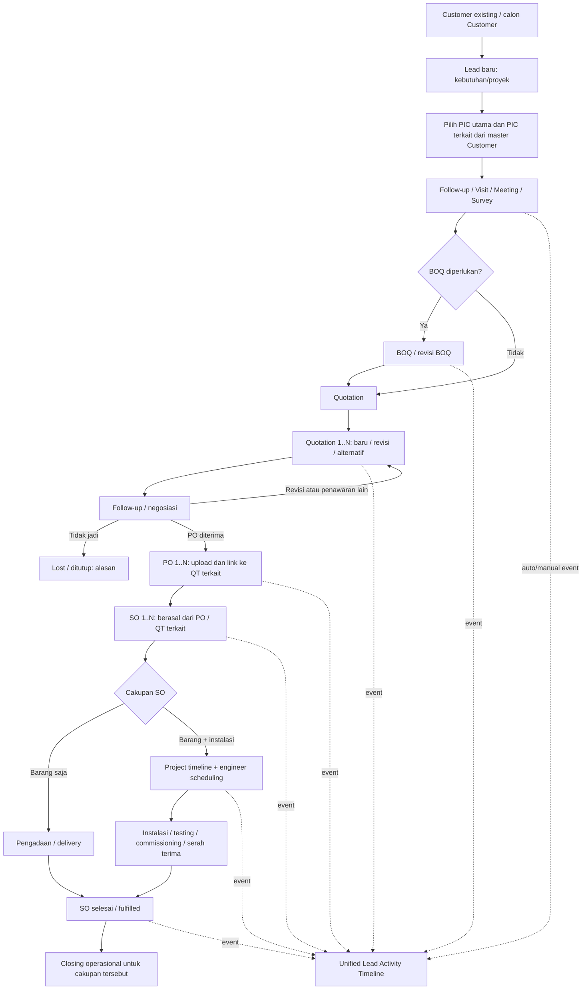
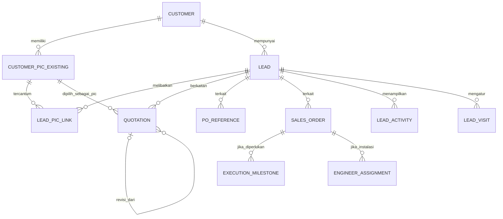

# Q-Sales (ACTiV) — PROMPT IMPLEMENTASI UPDATE LEAD 360° (V2)

> **Tujuan:** Kembangkan Lead Pipeline yang SUDAH BERJALAN menjadi pusat keterkaitan peluang bisnis, PIC, Quotation, PO, SO dan aktivitas lintas modul. **Jangan rebuild aplikasi atau mengganti workflow Customer/Quotation yang sudah berjalan.** Dokumen ini sekaligus spesifikasi bisnis, diagram, rencana perubahan aman, dan prompt untuk coding agent.
>
> **Sumber acuan:** `Walkthrough Fitur Lead Pipeline.md`, screenshot form **Tambah Customer Baru** (banyak PIC, PIC Utama), dan screenshot **Buat Quotation Baru** (pilih customer existing/buat baru, pilih/ubah PIC, tambah PIC, sales, masa berlaku, lanjut isi produk). Screenshot membuktikan UI tersebut tersedia, **bukan** struktur tabel dan endpoint tertentu. Perilaku backend harus diaudit di repository.

## A. Hal yang sudah ada dan WAJIB dipertahankan

1. `/leads`: Kanban/List, filter, statistik dinamis, drag-and-drop AJAX optimistis.
2. `/leads/{lead}`: detail lead, ubah stage tanpa reload, timeline aktivitas manual, link SPH.
3. `/leads/visits`: follow-up, jadwal visit, check-in GPS.
4. `/achievements`: dashboard target/realisasi dan filter.
5. Setting stage dinamis di `system_settings` key `lead_pipeline_settings` dengan tipe `normal / deal / lost`.
6. RBAC Sales Rep, Manager, Administrator; toast UI global.
7. Customer dapat menyimpan **banyak PIC** dan PIC utama; jangan buat ulang master PIC paralel.
8. Form Quotation sudah dapat memilih Customer dan PIC master, menambah PIC, menetapkan Sales dan masa berlaku, lalu mengisi produk. Tetap pertahankan flow ini.
9. Auto-convert Lead → Customer ketika menjadi Proyek Deal terdokumentasi di walkthrough: pertahankan kompatibilitas, audit agar tidak membuat Customer duplikat dan jangan mengasumsikan implementasi transaksinya tanpa mengecek kode.

## B. Model bisnis yang benar

- **Customer** = entitas perusahaan (mis. PT ABC). Satu Customer memiliki banyak PIC dari departemen berbeda. Field departemen/jabatan **hanya ditambahkan bila belum tersedia**, menggunakan data master PIC existing.
- **Lead** = satu peluang/kebutuhan/proyek, **bukan** sekadar satu perusahaan dan **bukan** satu quotation. Satu Customer dapat mempunyai banyak Lead.
- **Lead–PIC** = satu Lead bisa melibatkan banyak PIC Customer; tiap PIC punya peran dalam Lead (utama, teknis, purchasing, finance, lainnya). PIC di Quotation boleh berbeda dari PIC utama Lead, tetapi tetap berasal dari Customer yang sama.
- **Lead–Quotation** = satu Lead memiliki **0..N quotation**, baik quotation independen maupun beberapa revisi untuk satu kebutuhan. Quotation tetap dimiliki modul Quotation. Quotation juga boleh dibuat dari menu umum tanpa Lead (opsional memilih Lead terkait).
- **Lead–PO–SO** = satu Lead dapat terkait **0..N PO dan 0..N SO**. PO customer di-upload/ditautkan sesuai proses existing; SO diterbitkan setelah PO diterima/diotorisasi sesuai aturan sistem. Jangan mengasumsikan tabel PO terpisah; telusuri dahulu apakah PO hanya field/file di SO atau merupakan model tersendiri.
- **Instalasi opsional** = setelah SO, jalur fulfilment bisa pengiriman barang saja atau pengiriman + survey/instalasi/commissioning/handover. Kalender engineer & timeline proyek adalah lanjutan eksekusi, bukan syarat semua lead.
- **Lead timeline** = pusat baca aktivitas manual maupun event otomatis dari dokumen lain, tanpa menduplikasi dokumen/transaksi asli.

## C. Diagram arus end-to-end



**Kunci:** Deal komersial terkonfirmasi ketika PO valid diterima sesuai aturan bisnis, bukan ketika instalasi selesai. Stage `Proyek Berjalan`/`Proyek Selesai` merefleksikan delivery/eksekusi. Jika satu lead sudah punya SO, tetapi masih punya quotation tambahan terbuka, status detailnya harus dapat menunjukkan **partially won / masih aktif**. Jangan menggeser stage backward secara otomatis setiap kali quotation tambahan dibuat.

## D. Entity-relations, pakai model existing



`CUSTOMER_PIC_EXISTING`, `PO_REFERENCE`, `EXECUTION_MILESTONE`, dan `ENGINEER_ASSIGNMENT` adalah **nama konseptual**, bukan instruksi menciptakan tabel dengan nama itu. Periksa model/tabel existing dan extend seminimal mungkin. Relasi antar PO–QT–SO mungkin N:M/parsial; jangan dipaksa 1:1 jika data existing mendukung penggabungan/pemecahan transaksi.

## E. Usulan perubahan database MINIMAL dan aman

1. **Master Customer/PIC:** gunakan tabel PIC existing apa adanya. Bila departemen belum tersedia dan diperlukan, tambahkan `department` atau relasi department sesuai pola repository. Tidak perlu tabel `customer_contacts` baru bila master PIC sudah tersedia.
2. **Lead:** pertahankan `leads` existing. Tambahkan `customer_id` hanya jika belum ada; jika sebelumnya menggunakan teks untuk calon customer, tetap izinkan prospek belum terkonversi. Simpan pilihan PIC utama dengan FK hanya jika konsisten dengan model existing; gunakan pivot agar satu Lead mempunyai banyak PIC.
3. **Lead–PIC pivot** (`lead_pic` sebagai contoh, sesuaikan naming): `id?`, `lead_id`, `customer_pic_id`, `role`, `is_primary`, `notes?`, timestamps. Constraint: PIC harus milik Customer Lead; penentuan satu PIC utama harus transactional.
4. **Quotation link:** bila setiap Quotation boleh terkait tepat satu Lead, gunakan FK nullable `quotations.lead_id` dan indeksnya. Jika hubungan lebih kompleks/sudah ada pivot, gunakan existing dan jangan gandakan. Quotation tanpa Lead tetap valid. Tautkan ke PIC existing sesuai pola model Quotation saat ini.
5. **Revisi QT:** periksa kemampuan revisi existing. Bila tidak ada, rancang `revision_of_id` nullable atau revision group; **jangan** mengubah nomor QT lama secara merusak. Bedakan `revision`, `alternative`, `additional_scope`.
6. **PO/SO:** audit dulu schema dan upload PO yang existing. Tambahkan relasi ke lead, quotation, dan PO hanya jika dibutuhkan dan konsisten. Jika PO di-upload di modul SO, jadikan file/metadata PO itu sumber tunggal, **jangan membuat modul PO baru otomatis**.
7. **Lead Activity:** gunakan tabel `lead_activities` existing; extend dengan metadata aman (`source_type`, `source_id`, `event_key`, `occurred_at`, `actor_id`, `metadata` jika perlu). Idempotency: unique key yang stabil per source event; tanpa event duplikat bila proses retry. Jangan menyimpan ulang seluruh data QT, PO, SO.
8. **Instalasi/engineer:** prioritaskan membaca data proyek dan penjadwalan existing. Baru siapkan tabel milestone/task/assignment tambahan apabila belum ada. Setiap assignment punya engineer, rentang waktu, lokasi, status dan FK ke SO/project.
9. Tambahkan migrasi **aditif** dan backfill bertahap; semua FK baru nullable sampai data lama terpetakan. Tidak drop/rename kolom existing tanpa migrasi eksplisit dan review.

## F. Tampilan Lead Detail yang ditargetkan

**Header:** lead code, nama peluang, Customer, sales owner, stage Kanban, commercial status, estimated value, nilai PO/SO sesuai kebijakan, aksi Follow-up / Buat Quotation.

**Section/tab:**

- **Overview:** deskripsi peluang, kebutuhan, owner, tanggal dan milestone berikutnya.
- **PIC Terkait:** pilih PIC dari Customer; tandai PIC utama per lead, role tiap PIC, kontak; tampilkan PIC spesifik di tiap QT.
- **BOQ:** daftar/link BOQ beserta versi jika ada; tidak membuat modul baru jika existing.
- **Quotation (0..N):** nomor, tanggal, PIC, nilai, status, versi/revisi, relasi dokumen, tombol `Buat Quotation` dan `Tautkan Quotation Existing` bila perlu.
- **PO (0..N):** nomor customer PO, tanggal, nilai, status validasi, file upload/download sesuai modul, referensi QT.
- **SO (0..N):** nomor, tanggal, nominal, status delivery/fulfilment, referensi PO/QT, link detail.
- **Project / Instalasi (opsional):** milestone, jadwal, assignee engineer, progres, laporan instalasi/handover; jangan tampilkan kewajiban instalasi untuk penjualan barang saja.
- **Activity Timeline (gabungan):** time descending; filter `Semua / Aktivitas / BOQ / Quotation / PO / SO / Instalasi`; event memiliki waktu, actor, sumber/modul, nomor dokumen, PIC bila relevan, ringkasan perubahan serta link ke dokumen.

**Contoh timeline hipotetis:**

| Waktu | Event | Sumber |
|---|---|---|
| 18 Nov 2026 | SO-002 dibuat dari PO-002 | SO |
| 17 Nov 2026 | PO-002 di-upload & diverifikasi | PO |
| 14 Nov 2026 | QT-003 untuk PIC Purchasing dikirim | Quotation |
| 12 Nov 2026 | SO-001 dibuat dari PO-001 | SO |
| 10 Nov 2026 | PO-001 diterima | PO |
| 06 Nov 2026 | QT-002 revisi dari QT-001 dikirim | Quotation |
| 05 Nov 2026 | Meeting dengan PIC Engineering | Visit |
| 04 Nov 2026 | QT-001 dibuat | Quotation |

Nilai di dashboard **tidak boleh** menjumlahkan QT-001 dan QT-002 jika keduanya revisi dari kesempatan komersial yang sama. Definisi target/realisasi harus diverifikasi dengan pemilik proses bisnis dan laporan existing.

## G. Integrasi UI Quotation yang SUDAH ada

**Ketika dibuat dari Lead Detail:**
- Tombol `Buat Quotation` menuju flow Quotation existing dengan `lead_id`/state aman.
- Auto-pilih Customer dari Lead bila sudah diketahui.
- Drop-down PIC memuat semua PIC dari master Customer. Default boleh PIC utama Lead, **tetap bisa memilih PIC lain atau tambah PIC** dengan flow existing.
- Sales pembuat dan masa berlaku tetap mengikuti aturan form existing.
- Langkah `Lanjut & Isi Produk` tidak dirombak.
- Setelah Quotation berhasil tersimpan, link ke Lead, catat event otomatis, tampilkan di tab Quotation Lead.

**Ketika dibuat dari menu Quotations:**
- Alur normal tetap berfungsi tanpa Lead.
- Sediakan field opsional `Lead Terkait`, difilter berdasarkan Customer terpilih. Saat Customer berubah, reset pilihan Lead yang tidak valid.
- Tidak boleh menautkan Quotation ke Lead Customer lain tanpa proses koreksi yang eksplisit.

**Saat update Quotation:**
- Catat event create/update/status sent/approved/rejected/expired sesuai lifecycle riil, bukan status karangan.
- Untuk revisi, tampilkan hubungan ke versi sebelumnya tanpa menghilangkan riwayat.
- Jangan mengedit data QT melalui tampilan Lead; link ke modul Quotation untuk perubahan.

## H. Aturan stage dan status

- **Kanban stage:** tetap menggunakan configurable stage yang sudah ada. Nama stage saat ini `Data Masuk`, `SPH Terlayang`, `Hot Progress`, `Proyek Deal`, `Proyek Berjalan`, `Proyek Selesai`, `No Deal` tetap kompatibel.
- **Milestone** BOQ, Quotation, PO, SO dapat tampil sebagai indikator/aktivitas tambahan, **tidak wajib menjadi tujuh kolom kanban baru**.
- **Proyek Deal:** set bila PO customer diterima/valid sesuai aturan existing; jika sistem saat ini memakai manual stage, jangan ubah diam-diam sebelum mengonfirmasi trigger.
- **Proyek Berjalan:** ketika SO aktif, jika business rule existing menghendaki.
- **Proyek Selesai:** setelah semua scope/SO relevan selesai; jika ada add-on terbuka, gunakan indikator `open items` agar tidak menghilangkan informasi.
- **No Deal:** simpan lost reason; hindari memindahkan seluruh lead ke lost ketika satu dari beberapa QT ditolak tetapi QT lain berhasil.
- **commercial_status:** contoh `open`, `partially_won`, `won`, `lost` sebagai status tambahan terpisah bila benar-benar diperlukan.
- **fulfillment_status:** contoh `not_started`, `in_progress`, `partially_completed`, `completed` diturunkan dari SO/proyek. Jangan samakan deal dengan handover.

## I. Event-driven timeline dan konsistensi transaksi

Event yang mungkin dicatat (sesuaikan dengan status yang benar-benar tersedia):

`lead.created`, `lead.stage_changed`, `lead.pic_linked`, `lead.note_added`, `lead.follow_up_scheduled`, `visit.checked_in`, `boq.created`, `quotation.created`, `quotation.revised`, `quotation.sent`, `quotation.approved`, `quotation.rejected`, `po.uploaded`, `po.verified`, `so.created`, `so.status_changed`, `engineer.assigned`, `installation.started`, `installation.completed`, `handover.completed`.

- Event harus dipicu dari **server-side lifecycle** / service / observer yang sudah konsisten dengan aplikasi, bukan hanya dari klik tombol frontend.
- Simpan `lead_id`, waktu event, actor, event type, referensi source, metadata ringkas dan unique idempotency key.
- Gunakan transaksi atau after-commit/queue yang idempotent agar event tidak muncul saat transaksi dokumen gagal.
- Tampilkan event bersama aktivitas manual berdasarkan `occurred_at`, dengan pagination/filter. Lindungi attachment dan link dokumen menggunakan policy authorization modul aslinya.
- Perubahan data lama harus tetap dapat dilihat; buat backfill riwayat yang aman jika data histori dokumennya tersedia. Jangan membuat timestamp peristiwa historis yang tidak dapat dibuktikan.

## J. Audit repository yang WAJIB dilakukan sebelum coding

1. Baca migrations/models Customer dan master PIC; identifikasi FK aktual dan apakah departemen/jabatan ada.
2. Baca model/controller/page Quotation; identifikasi struktur nomor, PIC, revisi, status, relasi Customer, dan titik create/update.
3. Telusuri PO: di-upload di mana? File attachment, tabel PO tersendiri, atau field di Sales Order? Cari link PO→SO serta alur validasinya.
4. Telusuri model SO dan status delivery/closing serta sumber achievement/revenue.
5. Telusuri Lead, `lead_activities`, `LeadController`, `LeadDetail.jsx`, `Leads.jsx`, `/leads/visits`, setting stage dan policies.
6. Telusuri modul project/engineer/calendar bila ada; jangan mengasumsikan sudah ada dari screenshot.
7. Output awal audit berupa matriks **Exists / Needs extension / Unknown**, nama file dan kolom nyata, serta daftar perubahan aditif paling kecil.

## K. Implementasi bertahap agar aman

**Phase 0 — Audit dan mapping:** inventaris schema, route, service, authorization, status riil; pastikan keputusan teknis berdasarkan kode.

**Phase 1 — Relasi Lead ↔ Customer/PIC:** pivot PIC lead, validasi PIC milik Customer yang sama; migrasi aman, tampilkan PIC pada Lead Detail.

**Phase 2 — Multi Quotation:** tautkan banyak QT ke lead, `Buat Quotation` dari lead dengan prefill Customer, PIC selector existing, field Lead opsional dari Quotation umum; relasi revisi bila diperlukan.

**Phase 3 — PO & SO linkage:** gunakan model/upload PO yang sudah ada; tautkan banyak PO/SO ke lead dan ke transaksi yang tepat; tampilkan tab PO/SO; jangan melanggar integritas nilai.

**Phase 4 — Timeline otomatis:** server-side event, idempotency, backfill, filter dan deep links; pertahankan aktivitas manual serta AJAX optimistis existing.

**Phase 5 — Eksekusi opsional:** timeline instalasi dan kalender engineer hanya untuk SO yang memang punya scope instalasi; gunakan modul existing bila ada.

**Phase 6 — QA & rollout:** unit/integration tests, policy, migration/backfill, performance, validasi angka achievement, regression form Customer/Quotation/Lead.

## L. Acceptance criteria (wajib lolos)

- [ ] Satu Customer punya lebih dari satu PIC; daftar yang digunakan adalah **master PIC existing**, bukan salinan baru.
- [ ] Satu Customer punya dua atau lebih Lead berbeda tanpa mencampur dokumen.
- [ ] Satu Lead dapat memilih minimal dua PIC dengan role berbeda; PIC yang dipilih di setiap QT bisa berbeda.
- [ ] Buat QT dari Lead: Customer terisi; pilihan PIC tetap berfungsi; `Lanjut & Isi Produk` tetap normal; QT muncul di Lead.
- [ ] Buat QT langsung dari menu Quotation TANPA Lead tetap valid.
- [ ] Satu Lead menampilkan QT-001, QT-002 (revisi QT-001), QT-003 (tambahan) dengan status dan PIC masing-masing.
- [ ] Satu Lead menampilkan lebih dari satu PO dan SO, dengan link dokumen yang benar.
- [ ] Event QT/PO/SO tampil kronologis di timeline tanpa double log saat request retry.
- [ ] QT yang ditolak tidak membuat seluruh Lead Lost jika ada QT/SO lain yang aktif/menang.
- [ ] Penjualan barang saja dapat selesai tanpa tahap instalasi; SO instalasi memiliki schedule engineer dan timeline.
- [ ] Kanban drag/drop, filters, Visit GPS, Achievements, stage settings, RBAC, toast, customer conversion, dan form Quotation tidak regress.
- [ ] Akses lead, PIC, attachment PO, dan SO mengikuti otorisasi Sales/Manager/Admin serta policy dokumen.
- [ ] Nilai achievment tidak double-count revisi quotation atau PO/SO yang merepresentasikan transaksi yang sama.

## M. PROMPT SIAP TEMPEL KE CODING AGENT

```text
Anda adalah senior Laravel + React/Inertia engineer yang bekerja pada repository Q-Sales (ACTiV) yang SUDAH BERJALAN. Tugas Anda UPDATE, bukan rebuild, fitur Lead Pipeline menjadi Lead 360°.

KONTEKS TERKONFIRMASI:
- Lead sudah memiliki Kanban/List, drag/drop AJAX, stage settings dinamis, activity timeline manual, visit/follow-up GPS, Achievements, dan RBAC.
- Customer sudah punya banyak PIC dan PIC utama.
- Form Quotation sudah mendukung memilih/buat Customer, pilih/ubah/tambah PIC, Sales, masa berlaku, lalu lanjut isi produk.
- Proses bisnis: satu Customer -> banyak Lead (peluang/proyek); satu Lead -> banyak PIC -> banyak BOQ/Quotation (termasuk revisi & tambahan) -> banyak PO -> banyak SO; dapat ada instalasi dan engineer calendar, tetapi tidak selalu.
- Dokumen Quotation, PO, SO tetap dikelola di modul masing-masing. Lead Detail adalah pusat agregasi dan timeline lintas modul.

WAJIB SEBELUM MENGUBAH KODE:
1. Audit schema/model/controller/routes/React pages Customer+PIC, Quotation, PO/upload PO, SO, Lead+activities, stage settings, project/engineer (jika ada), RBAC, achievements.
2. Tuliskan matriks Exists / Needs extension / Unknown, relasi FK nyata, lifecycle status, titik event dan risiko migrasi. Jangan mengarang nama tabel/kolom PO, PIC, atau engineer.
3. Susun rencana perubahan ADITIF minimal; jangan membuat duplikat master Customer/PIC atau modul PO apabila sudah ada.

IMPLEMENTASI YANG DIMINTA:
A. Kaitkan Lead ke Customer existing dan banyak PIC Customer melalui pivot role dan primary contact (validasi customer matching).
B. Satu Lead punya banyak Quotation. Buat Quotation dari Lead dengan auto-prefill Customer dan opsi PIC existing. Jika dibuat dari menu Quotation, pemilihan Lead opsional berdasarkan customer. Jaga flow existing sampai Isi Produk.
C. Dukung relasi revisi QT vs QT tambahan; jangan double count nominal revision.
D. Link banyak PO dan SO ke Lead melalui sumber PO/SO yang SUDAH ADA, termasuk nomor, status, attachment, dan referensi dokumen.
E. Tambahkan tab Overview/PIC/Quotation/PO/SO/Timeline di Lead Detail; optional Instalasi bila SO ada scope instalasi.
F. Catat event otomatis server-side saat QT/PO/SO berubah (create, send, revise, upload, approve, SO create, status change). Gunakan log idempotent, waktu akurat, source reference, actor, deep link, tanpa menduplikasi transaksi.
G. Pertahankan configurable Kanban stage; jangan memindahkan Lead ke Lost karena satu QT gagal bila ada transaksi lainnya. Pisahkan indikator status komersial dari fulfillment/instalasi.
H. Buat migration, Eloquent relations, validation, policies, controllers/services/events, komponen React/Inertia, dan tests yang sesuai arsitektur nyata.

OUTPUT:
- Audit repo dan temuan faktual.
- Rencana perubahan per file/migration.
- Implementasi bertahap dengan kode dan tests.
- Hasil test/regression termasuk Customer multi PIC, quotation tanpa lead, multi QT/PO/SO, timeline, permission, dan achievement anti double-count.
- Sebutkan blocker yang membutuhkan keputusan bisnis; jangan mengarang implementasi eksisting.

BATASAN:
- Preserve data lama, URL utama, RBAC, UX Customer/Quotation, stage settings, drag/drop, Visits GPS.
- Tidak drop/rename existing schema tanpa strategi migrasi khusus.
- Tidak mengubah nilai achievement tanpa audit source of truth.
- Jangan menganggap calendar engineer, BOQ, PO adalah model mandiri sebelum audit repository.
```

---

**Status dokumen:** rancangan implementasi berbasis walkthrough dan dua screenshot, **belum review source code repository**. Contoh tanggal/transaksi ilustratif dan bukan data aplikasi riil.
