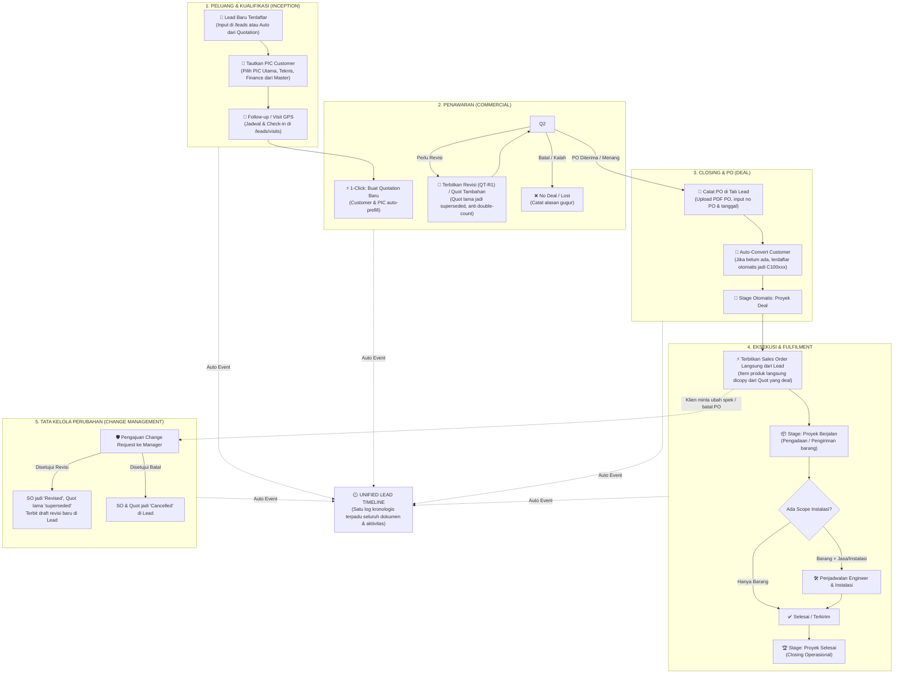
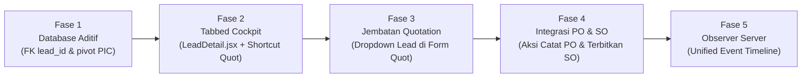

# 🧭 Rekomendasi Flow Lengkap: Lead 360° Cockpit — Q-Sales (ACTiV)

> **Dokumen Arsitektur & Panduan Alur Bisnis**  
> *Menghubungkan Peluang (Lead), Kontak PIC Customer, Multi-Quotation, Purchase Order (PO), Sales Order (SO), hingga Eksekusi/Instalasi dalam Satu Layar Terpadu (Single Cockpit).*

---

## 📑 Daftar Isi

1. [Filosofi Desain: Model Hub-and-Spoke](#1-filosofi-desain-model-hub-and-spoke)
2. [Diagram Alur End-to-End (Master Workflow)](#2-diagram-alur-end-to-end-master-workflow)
3. [Rincian 5 Tahapan Siklus Bisnis](#3-rincian-5-tahapan-siklus-bisnis)
   - [Tahap 1: Inisiasi Peluang & Multi-PIC Customer](#tahap-1-inisiasi-peluang--multi-pic-customer)
   - [Tahap 2: Penawaran Komersial (Multi-Quotation & Revisi)](#tahap-2-penawaran-komersial-multi-quotation--revisi)
   - [Tahap 3: Closing Deal & Pencatatan PO Klien](#tahap-3-closing-deal--pencatatan-po-klien)
   - [Tahap 4: Penerbitan Sales Order (SO) & Eksekusi](#tahap-4-penerbitan-sales-order-so--eksekusi)
   - [Tahap 5: Tata Kelola Perubahan (Change Management Loop)](#tahap-5-tata-kelola-perubahan-change-management-loop)
4. [Desain Layar: "The All-in-One Cockpit" Lead Detail](#4-desain-layar-the-all-in-one-cockpit-lead-detail)
5. [Simplifikasi Status Quotation: Tampilan Bersih vs Audit Database](#5-simplifikasi-status-quotation-tampilan-bersih-vs-audit-database)
6. [Strategi Adopsi Sales (Zero-Friction Transition)](#6-strategi-adopsi-sales-zero-friction-transition)
7. [Roadmap Implementasi Bertahap (Action Plan)](#7-roadmap-implementasi-bertahap-action-plan)

---

## 1. Filosofi Desain: Model Hub-and-Spoke

Dalam sistem CRM dan penjualan modern kelas dunia seperti **Salesforce (Opportunity Management)** dan **Jira (Epic/Issue Cockpit)**, sales tidak bekerja dengan berpindah-pindah menu secara terfragmentasi.

Sistem **Lead 360° Cockpit** di ACTiV menerapkan arsitektur **Hub-and-Spoke**:

* **HUB (Pusat Kendali):** Halaman **Detail Lead (`/leads/{id}`)**. Di sinilah sales menghabiskan 90% waktu kerjanya untuk memantau negosiasi, memilih PIC, menerbitkan Quotation, mencatat PO, dan memonitor SO.
* **SPOKES (Mesin Transaksi):** Modul Quotation, PO, SO, dan Finance tetap beroperasi sesuai regulasi akuntansi masing-masing, tetapi dapat dieksekusi dan dipantau langsung dari layar Lead.

$$\text{1 Customer (PT)} \longrightarrow \text{N Peluang (Lead)} \longrightarrow \text{N Kontak (PIC)} \longrightarrow \text{N Penawaran (Quotation)} \longrightarrow \text{N Dokumen PO} \longrightarrow \text{N Sales Order (SO)}$$

---

## 2. Diagram Alur End-to-End (Master Workflow)



---

## 3. Rincian 5 Tahapan Siklus Bisnis

### Tahap 1: Inisiasi Peluang & Multi-PIC Customer
1. **Dua Titik Masuk Fleksibel:**
   * **Jalur Cepat Lead (Rekomendasi):** Sales membuat peluang baru di papan Kanban [Lead Pipeline](/leads).
   * **Jalur Kebiasaan Lama:** Jika sales langsung membuka form `/quotations/create`, sistem otomatis menyediakan pilihan *Tautkan ke Peluang Lead*, atau membuatkan kartu Lead secara otomatis di background.
2. **Multi-PIC Peran:** Satu peluang dapat menghubungkan beberapa kontak dari satu Customer yang sama:
   * **PIC Utama:** Pengambil keputusan komersial.
   * **PIC Teknis:** Menangani uji coba perangkat / approval spesifikasi teknis.
   * **PIC Purchasing / Finance:** Mengurus penerbitan PO dan penagihan invoice.
3. **Log Interaksi Awal:** Sales merekam catatan panggilan telepon, pesan WhatsApp, atau jadwal pertemuan tatap muka lengkap dengan check-in koordinat GPS.

---

### Tahap 2: Penawaran Komersial (Multi-Quotation & Revisi)
1. **Shortcut Cepat `+ Buat Quotation`:** Tombol di layar Lead langsung membuka form Quotation dengan data Customer, PIC, Sales, dan tanggal yang **sudah terisi otomatis**. Sales hanya perlu memilih daftar produk dan diskon.
2. **Multi-Quotation dalam 1 Proyek:**
   * Satu proyek dapat memiliki lebih dari satu Quotation, baik penawaran penambahan scope (*Additional Scope*) maupun penawaran revisi (*Revision*).
   * **Anti Double-Count:** Perhitungan nilai estimasi proyek tidak menjumlahkan Quotation lama dan Quotation revisi secara ganda.
3. **Penyederhanaan Status Quotation di Mata Sales:**
   * `Draft`: Quotation sedang dipersiapkan.
   * `Sent`: Quotation resmi sudah dikirim ke klien dan sedang dinegosiasikan.
   * `PO (Approved)`: Quotation disetujui klien.
   * `Closed (Reject/Expired)`: Quotation tidak berlanjut.

---

### Tahap 3: Closing Deal & Pencatatan PO Klien
1. **Catat PO Langsung dari Layar Lead:**
   * Sales membuka Tab **Purchase Order (PO)** pada detail Lead.
   * Klik tombol **`+ Catat PO / Upload Dokumen PO`**.
   * Pilih Quotation mana yang disetujui, masukkan nomor PO klien, tanggal PO, dan upload file PDF asli dari customer.
2. **Auto-Convert Customer:** Jika lead berasal dari calon klien baru, sistem secara otomatis menerbitkan kode Customer resmi (`C100xxx`) tanpa input manual ulang.
3. **Otomasi Tahap Pipeline:** Kartu Lead otomatis bergeser ke kolom **"Proyek Deal"**.

---

### Tahap 4: Penerbitan Sales Order (SO) & Eksekusi
1. **Terbitkan SO 1-Click dari Lead:**
   * Pada Tab **Sales Order** di layar Lead, terdapat tombol aksi:
     $$\textbf{[ ⚡ Terbitkan Sales Order dari PO-001 ]}$$
   * Seluruh rincian barang, harga, dan syarat pembayaran dari Quotation terkait otomatis di-copy ke SO baru.
2. **Dua Jalur Fulfilment:**
   * **Barang Saja:** SO diteruskan ke tim gudang/logistik ➔ Pengiriman ➔ Proyek Selesai.
   * **Barang + Instalasi:** Terhubung ke jadwal engineer ➔ Pemasangan, testing, commissioning ➔ Berita Acara Serah Terima (BAST) ➔ Proyek Selesai.
3. **Status Pipeline:** Otomatis bergerak dari **"Proyek Berjalan"** hingga **"Proyek Selesai"**.

---

### Tahap 5: Tata Kelola Perubahan (Change Management Loop)
Jika customer meminta perubahan spek atau membatalkan pesanan setelah SO terbit:
1. Sales mengajukan **Change Request** ke Manager langsung melalui Lead.
2. Saat Manager menyetujui:
   * **Revisi:** SO lama berstatus `Revised`, Quotation lama berstatus `superseded`, dan sistem otomatis menerbitkan draft revisi baru (`revision_draft`) langsung di tab Quotation pada Lead tersebut.
   * **Batal:** SO dan Quotation ditandai `cancelled`.
3. **Jejak Audit Lengkap:** Semua alasan dan persetujuan manager tercatat otomatis di timeline Lead tanpa merusak pembukuan akuntansi.

---

## 4. Desain Layar: "The All-in-One Cockpit" Lead Detail

Halaman [`/leads/{id}`](http://127.0.0.1:8002/leads) dirancang menjadi pusat kerja komprehensif berbasis Tab:

```
┌────────────────────────────────────────────────────────────────────────────────────────┐
│ ← Kembali ke Pipeline   [L2611.001] [🔥 Hot Progress]                 [Ubah Stage ▾]   │
│ Proyek Pengadaan Server & Jaringan - PT Alfa Cipta                                     │
│ Est. Nilai: Rp 450.000.000  ·  Owner: Nabil Sales  ·  Customer: PT Alfa Cipta         │
├─────────────┬──────────────┬─────────────────┬──────────────┬──────────────┬───────────┤
│ 📋 Overview │ 👥 PIC (3)   │ 📄 Quotation (2)│ 📑 PO (1)    │ 📦 SO (1)    │ 🕒 Timeline│
├─────────────┴──────────────┴─────────────────┴──────────────┴──────────────┴───────────┤
│                                                                                        │
│ [Tab 1: Overview]                                                                      │
│ Deskripsi kebutuhan klien, estimasi nilai deal, target tanggal closing, catatan sales.  │
│                                                                                        │
│ [Tab 2: PIC Terkait]                                                                   │
│ • Bpk. Hendra (Utama - Direktur Operasional) | 0812-xxxx | hendra@alfacipta.co.id       │
│ • Ibu Siti    (Purchasing)                  | 0818-xxxx | siti@alfacipta.co.id         │
│ • Mas Doni    (IT Support / Teknis)         | 0857-xxxx | doni@alfacipta.co.id         │
│ [+ Tambah/Tautkan PIC dari Customer]                                                   │
│                                                                                        │
│ [Tab 3: Quotation]                                                                     │
│ [+ Buat Quotation Baru]                                                                │
│ ────────────────────────────────────────────────────────────────────────────────────── │
│ • QT-2611-001-R1  | Rp 450.000.000 | [Sent (Aktif)]  | PIC: Budi IT    | [Lihat Quot]  │
│ • QT-2611-001-R0  | Rp 480.000.000 | [Superseded]    | PIC: Budi IT    | [Riwayat]     │
│                                                                                        │
│ [Tab 4: Purchase Order (PO)]                                                           │
│ [+ Catat / Upload Dokumen PO]                                                          │
│ ────────────────────────────────────────────────────────────────────────────────────── │
│ • PO No: PO-AC-2026-99 | Tgl: 03 Nov 2026 | Nilai: Rp 450.000.000 | [Download PDF]     │
│                                                                                        │
│ [Tab 5: Sales Order (SO)]                                                              │
│ [⚡ Terbitkan Sales Order dari PO-AC-2026-99]                                           │
│ ────────────────────────────────────────────────────────────────────────────────────── │
│ • SO-2611-008 | Tgl: 03 Nov 2026 | Status: Sedang Dikirim | Rp 450.000.000 | [Lihat SO]│
│                                                                                        │
│ [Tab 6: Unified Timeline]                                                              │
│ Riwayat kronologis otomatis: pembuatan Quotation, pengiriman penawaran, revisi,        │
│ upload PO, terbit SO, serta catatan panggilan telepon & check-in GPS sales.            │
│                                                                                        │
└────────────────────────────────────────────────────────────────────────────────────────┘
```

---

## 5. Simplifikasi Status Quotation: Tampilan Bersih vs Audit Database

Untuk menjaga kenyamanan sales tanpa mengorbankan akurasi audit:

| Tampilan Sederhana di Layar Sales | Status Asli di Database | Fungsi & Peran Teknis di Sistem |
| :--- | :--- | :--- |
| **Draft** | `created`, `revision_draft` | Quotation baru dibuat atau draft revisi hasil persetujuan Manager yang sedang diisi produk. |
| **Sent (Quotation Terkirim)** | `sent` | Penawaran resmi sudah dikirim ke customer dan sedang dinegosiasikan. |
| **PO (Deal / Approved)** | `approved` | PO klien sudah diterima; harga terkunci dan menjadi dasar penerbitan SO. |
| **Closed (Reject)** | `rejected` | Penawaran ditolak oleh customer (alasan tercatat). |
| **Closed (Expired)** | `expired` | Melewati batas 14 hari masa penawaran tanpa konfirmasi. |
| **Tergantikan (Archived)** | `superseded` | Penawaran versi lama yang sudah digantikan oleh nomor revisi baru (tidak dihitung ganda). |
| **Dibatalkan Resmi** | `cancelled` | Transaksi dibatalkan atas persetujuan Manager melalui Change Request. |

---

## 6. Strategi Adopsi Sales (Zero-Friction Transition)

Agar tim sales berpindah dari kebiasaan lama (langsung input di menu Quotation) ke Lead Pipeline secara alami:

1. **Jalur Cepat (*The Speed Incentive*):**
   * Tunjukkan bahwa membuat penawaran dari Lead **memotong 5 langkah membosankan** (Customer, PIC, Sales, dan Tanggal sudah terisi otomatis).
2. **Jembatan Cerdas (*The Safety Net*):**
   * Di menu lama `/quotations/create`, sediakan opsi dropdown *Tautkan ke Peluang Lead*. Jika sales lupa, sistem otomatis membuatkan 1 kartu Lead di tahapan *Quotation Terkirim*.
3. **Pemberitahuan Otomatis (*Follow-up Reminder*):**
   * Kanban Lead menampilkan penanda visual jika ada prospek yang tidak di-follow up lebih dari 3 hari. Ini membantu sales mengamankan komisi closing mereka.
4. **Laporan Otomatis ke Manager:**
   * Karena seluruh riwayat visit, telepon, Quotation, dan PO tercatat rapi di Lead, sales tidak perlu lagi membuat rekap laporan manual mingguan ke atasan.

---

## 7. Roadmap Implementasi Bertahap (Action Plan)

Perubahan ini bersifat **aditif (aman & tidak merusak data berjalan)** melalui 5 langkah:



* **Fase 1 (Skema Database):**
  * Tambah kolom nullable `quotations.lead_id`.
  * Buat tabel pivot `lead_pics` (`lead_id`, `customer_pic_id`, `role`, `is_primary`).
* **Fase 2 (Frontend Cockpit Lead):**
  * Perbarui `LeadDetail.jsx` dengan tata letak Tab: *Overview*, *PIC*, *Quotation*, *PO*, *SO*, *Timeline*.
  * Tambahkan tombol `+ Buat Quotation` yang meneruskan parameter `?lead_id=...`.
* **Fase 3 (Jembatan Menu Quotation):**
  * Perbarui `QuotationCreate.jsx` untuk membaca parameter `lead_id` dan menyediakan dropdown opsional memilih Lead aktif Customer.
* **Fase 4 (Tab PO & SO di Lead):**
  * Hubungkan model `QuotationPurchaseOrder` dan `SalesOrder` agar tampil di tab Lead terkait.
  * Tambahkan tombol pintasan *Terbitkan SO* langsung dari kartu PO.
* **Fase 5 (Observer Unified Timeline):**
  * Pasang Laravel Model Observer pada `Quotation` dan `SalesOrder` untuk otomatis mencatat riwayat event ke tabel `lead_activities`.

