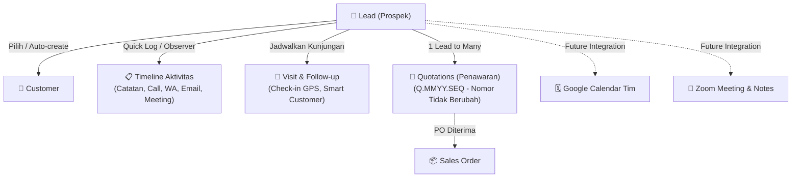

# 📖 Walkthrough Lengkap: Fitur Lead Pipeline & Lead 360° — Q-Sales (ACTiV)

Dokumen ini berisi panduan komprehensif, arsitektur data, dan dokumentasi operasional untuk seluruh pembaruan **Fitur Lead Pipeline, Timeline Aktivitas, Integrasi Quotation (Lead 360° Phase 1), serta Pembersihan Duplikasi Customer** pada sistem **Q-Sales (ACTiV)**.

---

## 📑 Daftar Isi

1. [Arsitektur & Konsep Lead 360°](#1-arsitektur--konsep-lead-360)
2. [Pencegahan & Penggabungan Duplikasi Customer (Deduplication)](#2-pencegahan--penggabungan-duplikasi-customer-deduplication)
3. [Pipeline Board (Kanban & List View)](#3-pipeline-board-kanban--list-view)
4. [Detail Lead & Timeline Aktivitas Interaktif](#4-detail-lead--timeline-aktivitas-interaktif)
5. [Integrasi Lead ⇄ Quotation (Phase 1)](#5-integrasi-lead--quotation-phase-1)
6. [Smart Visit & Follow-up (Kunjungan Lapangan)](#6-smart-visit--follow-up-kunjungan-lapangan)
7. [Daftar Yang Sudah Dikerjakan (Completed)](#7-daftar-yang-sudah-dikerjakan-completed)
8. [Daftar Yang Belum Dikerjakan (Pending Roadmap)](#8-daftar-yang-belum-dikerjakan-pending-roadmap)

---

## 1. Arsitektur & Konsep Lead 360°

Fitur Lead berfungsi sebagai **Cockpit Komersial** terpadu bagi tim sales. Siklus hidup prospek terhubung langsung dengan Customer, Aktivitas Lapangan, Penawaran (Quotation), hingga Sales Order (SO).



---

## 2. Pencegahan & Penggabungan Duplikasi Customer (Deduplication)

Untuk menjamin integritas data (tidak ada nama PT ganda seperti *ExxonMobil* atau *FWD Insurance*):

### A. Proteksi Database & Validasi
* **Database Migration**: Index unik `customers_name_unique` pada kolom `customers.name`.
* **Backend Validation**:
  - `CustomerController::store()`: `'name' => 'required|string|max:255|unique:customers,name'`
  - `CustomerController::update()`: `'name' => 'required|string|max:255|unique:customers,name,' . $customer->id`

### B. Otomatisasi CLI Merger untuk cPanel / Production
Perintah artisan khusus untuk memindai dan menggabungkan data ganda tanpa menghilangkan relasi Quotation atau SO:
```bash
# Simulasi pengecekan duplikat tanpa mengubah database:
php artisan customers:merge-duplicates --dry-run

# Eksekusi penggabungan otomatis:
php artisan customers:merge-duplicates --force
```
*Aturan Merge:* Customer tertua dipertahankan (**KEEP**), PIC dipindahkan (duplikat email dibersihkan), seluruh Quotation, Sales Order, dan Lead dialihkan ke ID yang dipertahankan, lalu data duplikat dihapus (**REMOVE**).

### C. Antarmuka UI (Khusus Administrator & Sales Manager)
* Tombol **"Gabung Duplikat"** pada halaman `/customers` (ikon git-merge amber).
* Membuka modal pemindai real-time yang menampilkan grup nama kembar, perbandingan jumlah transaksi/PIC, dan tombol 1-klik gabung.

---

## 3. Pipeline Board (Kanban & List View)

URL: `/leads`

* **Dynamic Header Cards**: Menampilkan Total Lead, 2 kartu pilihan dinamis (default: *Hot Progress* & *Proyek Deal* dengan dropdown switcher langsung di kartu), dan Total Estimasi Nilai.
* **Full-Height Responsive Kanban**: Mengisi viewport layar tanpa terpotong dengan slider navigasi horizontal atas.
* **Silent Background Drag & Drop**: Menggeser kartu antar stage menggunakan Axios background AJAX tanpa reload halaman dan tanpa memicu progress bar Inertia.
* **Auto Customer Conversion**: Ketika lead digeser ke tahap `proyek_deal`, jika lead belum memiliki `customer_id`, sistem otomatis mendaftarkan perusahaan menjadi Customer baru.

---

## 4. Detail Lead & Timeline Aktivitas Interaktif

URL: `/leads/{lead}`

### A. Quick Log Bar (Tanpa Pop-up Modal)
Sales dapat langsung merekam aktivitas harian secara instan melalui 5 tombol aksi:
* 📝 **Catatan** (`note`): Catatan internal atau progress proyek.
* 📞 **Log Telepon** (`call`): Ringkasan panggilan telepon dengan customer.
* 💬 **Log WhatsApp** (`whatsapp`): Ringkasan percakapan chat/WA.
* 📧 **Log Email** (`email`): Notulen korespondensi email.
* 🎥 **Meeting** (`meeting`): Hasil meeting tatap muka atau video conference.

### B. Inline Editing & Hover Actions
* **Edit Cepat**: Arahkan kursor ke item aktivitas → klik ✏️ → form edit inline menggantikan item tanpa pop-up.
* **Hapus Aman**: Klik 🗑️ dengan konfirmasi.
* **System Safeguard**: Aktivitas yang dibuat oleh sistem (`stage_change`, `quotation_linked`, `deal_won`, `deal_lost`) tidak dapat diedit atau dihapus secara manual.

### C. Timeline Grouping by Date
Aktivitas dikelompokkan berdasarkan tanggal kejadian:
* **Hari ini**
* **Kemarin**
* **Tanggal lengkap (contoh: 3 November 2026)**

---

## 5. Integrasi Lead ⇄ Quotation (Phase 1)

### A. Skema Relasi Database
* Kolom `quotations.lead_id` (`UUID`, nullable, foreign key ke `leads.id`).
* Relasi Eloquent:
  - `Lead::quotations()` -> `hasMany(Quotation::class, 'lead_id')`
  - `Quotation::lead()` -> `belongsTo(Lead::class, 'lead_id')`
* **Format Penomoran Quotation**: Standar `{CODE}.{MMYY}.{SEQ}` (contoh: `Q.1126.001`) tetap dipertahankan 100%.

### B. Pembuatan Quotation dari Lead
1. Di halaman **Lead Detail**, terdapat tombol **`+ Buat Quotation`** di header dan di card Quotation.
2. Mengarahkan ke `/quotations/create?lead_id={lead_id}&customer_id={customer_id}`.
3. Form pembuatan Quotation otomatis mengunci Lead dan mengisi Customer serta PIC terkait.
4. Begitu Quotation tersimpan, sistem otomatis mencatat aktivitas pada timeline Lead:
   > *"Quotation dibuat: Q.1126.001 dan terhubung ke lead ini."*

### C. Card Quotation di Lead Detail
Sidebar menampilkan card **Quotation ({count})** yang merangkum:
* Nomor Quotation (`Q.xxxx`)
* Label revisi jika ada (`Rev 1`, `Rev 2`)
* Nominal Grand Total terformat (`Rp xx.xxx.xxx`)
* Status dokumen (`created`, `sent`, `approved`, dll.)
* Link satu klik menuju halaman detail Quotation.

---

## 6. Smart Visit & Follow-up (Kunjungan Lapangan)

URL: `/leads/visits`

Menyelesaikan kendala formulir yang membingungkan ketika Lead sudah memiliki data Customer:
* **Otomatisasi Customer**: Saat Sales memilih **Lead**, dropdown Customer otomatis **disembunyikan** dan digantikan informasi ringkas:
  > *"Customer otomatis dari Lead: PT. ExxonMobil"* (dengan tombol kecil *"Ubah"* jika ingin override).
* **Kunjungan Langsung**: Jika tidak memilih Lead, form tetap ringkas dengan link toggle:
  > *`+ Kunjungan langsung ke Customer (tanpa Lead)`*
* **Fallback Backend**: Jika request menyimpan kunjungan dengan `lead_id` tanpa `customer_id`, backend otomatis mengambil `customer_id` dari data Lead terkait.

---

## 7. Daftar Yang Sudah Dikerjakan (Completed)

| Fitur / Komponen | Status | Catatan Teknis |
|---|---|---|
| **Merge Customer Duplikat** | ✅ Selesai | Script CLI & migration selesai dijalankan, 0 duplikat tersisa |
| **Unique Constraint Customer Name** | ✅ Selesai | Index unik `customers_name_unique` aktif di DB & validasi controller |
| **Admin UI Gabung Duplikat** | ✅ Selesai | Modal scan & merge 1-klik di `/customers` (Role Admin/Manager) |
| **Artisan Command CLI** | ✅ Selesai | `php artisan customers:merge-duplicates` siap untuk deploy cPanel |
| **Kanban Pipeline Board** | ✅ Selesai | Drag-and-drop silent AJAX, dynamic header cards, scroll controller |
| **Quick Log Bar Lead Timeline** | ✅ Selesai | 5 tipe aktivitas: Catatan, Call, WA, Email, Meeting |
| **Inline Edit/Delete Activity** | ✅ Selesai | Role/ownership guard, system activity protection |
| **Date Grouping Timeline** | ✅ Selesai | Grouping "Hari ini", "Kemarin", "Tanggal" |
| **Migration `quotations.lead_id`** | ✅ Selesai | Kolom UUID nullable aktif dengan foreign key |
| **Migration `lead_pics`** | ✅ Selesai | Tabel pivot PIC level lead dengan role context aktif |
| **Prefill Lead di Buat Quotation** | ✅ Selesai | Param `?lead_id=` auto-select lead & customer di `QuotationCreate.jsx` |
| **Dropdown Lead di Buat Quotation** | ✅ Selesai | Sales bisa menghubungkan penawaran baru ke Lead manapun |
| **Quotation Card di Lead Detail** | ✅ Selesai | Daftar quotation terhubung, status, revisi, dan total rupiah |
| **Smart Visit Customer Selection** | ✅ Selesai | Auto-hide dropdown customer jika lead dipilih, toggle link direct |
| **Terminologi Standar** | ✅ Selesai | Menggunakan label "Quotation" / "Quot", bukan "SPH" |
| **Standardisasi Toast Notification** | ✅ Selesai | Global white card style `#ffffff` dengan aksen teal `#009680` |

---

## 8. Daftar Yang Belum Dikerjakan (Pending Roadmap)

Berikut adalah backlog fitur yang telah didiskusikan dan siap dikerjakan pada fase berikutnya:

### A. Lead 360° Cockpit (Fase Lanjutan)
1. **Backlink dari Quotation ke Lead**:
   - Di halaman detail Quotation (`/quotations/{id}`), tambahkan banner/link: *"Penawaran ini terhubung dengan Lead: [L2611.001] Proyek UPVC Gedung A"*.
2. **Tabbed Navigation di Lead Detail**:
   - Transformasi halaman Lead Detail menjadi mode tab:
     - `Overview`: Ringkasan profil, PIC, estimasi nilai, dan status.
     - `Quotation`: Tabel lengkap semua penawaran & riwayat revisi.
     - `PO & SO`: Riwayat purchase order customer dan status sales order operasional.
     - `Timeline & Kunjungan`: Seluruh jejak audit dan jadwal kunjungan.
3. **Manajemen PIC Multi-Peran (`lead_pics`)**:
   - Form modal untuk menambahkan beberapa PIC sekaligus ke dalam satu Lead dengan peranan spesifik (*Primary Contact*, *User Teknis*, *Purchasing/Pengadaan*, *Finance/Pembayaran*).

### B. Integrasi Google Calendar Tim (Shared Calendar)
1. **Koneksi Akun Gmail Kantor (`calendar@kantor.com`)**:
   - Modul OAuth / Service Account Google di menu **Settings → Integrasi**.
   - Admin menghubungkan 1 akun Google Calendar kantor.
2. **Sinkronisasi Dua Arah Kunjungan**:
   - Setiap kali Sales menjadwalkan kunjungan di `/leads/visits`, otomatis membuat event di Google Calendar kantor.
   - Karena sales lain sudah subscribe ke calendar kantor, jadwal otomatis muncul di aplikasi Google Calendar handphone masing-masing.
   - Kolom `gc_event_id` pada tabel `lead_visits` untuk sinkronisasi update/cancel jadwal.
3. **Halaman Kalender Tim (`/team-calendar`)**:
   - Tampilan visual kalender bulanan/mingguan di dalam portal Q-Sales yang menggabungkan seluruh jadwal kunjungan dan meeting tim sales.

### C. Integrasi Zoom Server-to-Server
1. **Setup Zoom Server-to-Server OAuth**:
   - Input Client ID, Client Secret, dan Account ID dari Zoom App Marketplace di halaman Settings Admin.
2. **Flag Lisensi User**:
   - Checkbox pada User Management: *"Memiliki Lisensi Zoom"*.
3. **Tombol "Jadwalkan Zoom Meeting"**:
   - Pembuatan link meeting Zoom otomatis langsung dari form Visit atau Lead Detail.
   - Link meeting otomatis ditempelkan ke event Google Calendar dan timeline Lead.
4. **Zoom Webhook Handler**:
   - Menerima webhook saat meeting berakhir (`meeting.ended`) untuk mencatat durasi aktual dan URL rekaman meeting ke timeline.

### D. Prosedur Deploy ke cPanel Production
Saat melakukan rilis ke server production cPanel, lakukan urutan berikut:
```bash
# 1. Jalankan merger duplikasi SEBELUM migrate (PENTING):
php artisan customers:merge-duplicates --force

# 2. Baru jalankan migration database:
php artisan migrate

# 3. Build assets (atau upload folder public/build hasil lokal):
bun run build
```
