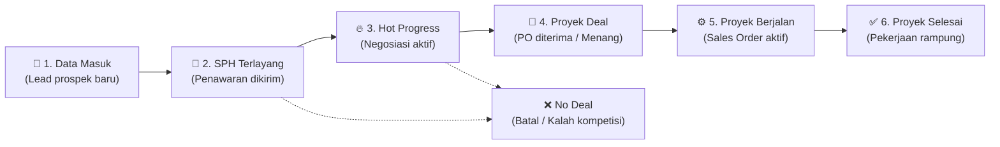

# 📖 Walkthrough: Fitur Lead Pipeline — Q-Sales (ACTiV)

Dokumen ini berisi panduan lengkap dan rangkuman implementasi teknis untuk **Fitur Lead Pipeline** pada portal **Q-Sales (ACTiV)**. Fitur ini dirancang untuk mengelola alur prospek (leads) mulai dari prospek pertama kali masuk hingga deal/menang dan terkonversi menjadi Customer & Quotation secara terintegrasi.

---

## 📑 Daftar Isi

1. [Gambaran Umum & Alur Kerja](#1-gambaran-umum--alur-kerja)
2. [Struktur Menu & Navigasi](#2-struktur-menu--navigasi)
3. [Dashboard Pipeline Board (Kanban & List)](#3-dashboard-pipeline-board-kanban--list)
4. [Halaman Detail Lead & Timeline Aktivitas](#4-halaman-detail-lead--timeline-aktivitas)
5. [Manajemen Visit & Follow-up](#5-manajemen-visit--follow-up)
6. [Menu Laporan Pencapaian (Achievements)](#6-menu-laporan-pencapaian-achievements)
7. [Pengaturan Tahap Pipeline (Manager & Admin)](#7-pengaturan-tahap-pipeline-manager--admin)
8. [Standardisasi Sistem Notifikasi (Toast)](#8-standardisasi-sistem-notifikasi-toast)
9. [Hak Akses & Matrix Permission (RBAC)](#9-hak-akses--matrix-permission-rbac)
10. [Spesifikasi Teknis & Endpoints](#10-spesifikasi-teknis--endpoints)

---

## 1. Gambaran Umum & Alur Kerja

Lead Pipeline menjembatani proses penjualan awal sebelum penawaran (Quotation) dan Sales Order (SO) diterbitkan.



### Integrasi Otomatis dengan Modul Lain:
* **Auto Customer Conversion:** Ketika sebuah lead masuk ke tahap **Proyek Deal**, sistem otomatis memeriksa apakah perusahaan sudah terdaftar sebagai Customer. Jika belum, sistem otomatis membuat data Customer baru (`C100xxx`) tanpa perlu input ulang manual.
* **Integrasi Quotation:** Lead dapat ditautkan dengan Quotation (SPH) yang sudah dibuat, sehingga status dokumen dapat langsung dicek dari papan pipeline.

---

## 2. Struktur Menu & Navigasi

Sidebar aplikasi diperbarui dengan pengelompokan yang rapi dan hak akses berbasis role:

```
MAIN
├── 📊 Dashboard
├── 📈 Lead Pipeline (Submenu Expandable)
│   ├── • Pipeline Board       -> /leads
│   └── • Visit & Follow-up    -> /leads/visits
├── 📄 Quotations              -> /quotations
├── 📦 Sales Orders            -> /sales-orders
├── 👥 Customers               -> /customers
└── 🏷️ Products                -> /products

REPORTS
├── 📊 Analytics               -> /analytics
├── 🏆 Pencapaian              -> /achievements (Khusus Sales Manager & Admin)
└── 🛡️ Manager View            -> /manager (Khusus Manager View)

SYSTEM
├── 👥 User Management         -> /users
└── ⚙️ Settings                -> /settings
```

---

## 3. Dashboard Pipeline Board (Kanban & List)

URL: `/leads`

### A. 4 Card Ringkasan Cerdas di Header
Bagian atas menampilkan 4 metrik performa yang **100% dinamis**:
1. **Total Lead:** Menghitung jumlah seluruh lead yang tampil sesuai filter pencarian/sales yang sedang aktif.
2. **Card Status Pilihan 1 (Dinamis):**
   - Menampilkan jumlah lead pada stage terpilih (default: *Hot Progress*).
   - **Quick Switcher (Manager/Admin):** Terdapat dropdown langsung di kartu untuk mengganti status stage yang ingin dipantau tanpa harus membuka menu pengaturan.
3. **Card Status Pilihan 2 (Dinamis):**
   - Menampilkan jumlah lead pada stage terpilih (default: *Proyek Deal*).
   - Dilengkapi selector cepat untuk Manager/Admin.
4. **Est. Total Nilai:** Akumulasi nilai nominal rupiah dari semua lead yang tampil.

### B. Fitur Unggulan Kanban Board
* **Tampilan Full-Height:** Tinggi kolom kanban otomatis mengisi layar ke bawah (`calc(100vh - 270px)`), rapi dan tidak terpotong.
* **Top Scroll Controller (Navigasi Horizontal Atas):**
  - Tombol navigasi panah kiri `<` dan kanan `>`.
  - Slider kontrol posisi horizontal.
  - Indikator kolom yang sedang terlihat di layar (contoh: *"Tahap 1–4 dari 7"*).
* **Drag-and-Drop Instan (Silent Background AJAX):**
  - Kartu lead dapat digeser langsung dari satu kolom stage ke stage lain.
  - Nilai statistik pada card header dan kolom kanban langsung ter-update secara **optimistic**.
  - Request tersimpan di background via Axios tanpa kedipan layar (*zero page reload*) dan tanpa memicu loading bar atas Inertia.
  - Muncul notifikasi toast hijau elegan yang mengonfirmasi perubahan.

### C. List View & Toolbar Filter
* Toggle view antara **Kanban** dan **List Tabel**.
* Pencarian cepat berdasarkan nama lead, nama perusahaan customer, atau no lead code (`L2611.xxx`).
* Filter per Tahap Stage.
* Filter per Sales Rep (khusus akun Manager & Admin).

---

## 4. Halaman Detail Lead & Timeline Aktivitas

URL: `/leads/{lead_id}`

Halaman ini berfungsi sebagai pusat informasi komprehensif untuk satu prospek:
* **Informasi Profil Lead:** Data perusahaan, telepon, email, nama Sales penanggung jawab, sumber prospek (Referral, Website, Cold Call, dll), dan tanggal dibuat.
* **Tautan SPH / Dokumen Penawaran:** Shortcut langsung ke halaman detail Quotation jika SPH sudah dilampirkan.
* **Ubah Stage Cepat Tanpa Loading:**
  - Klik tombol **"Ubah Stage"** untuk membuka deretan tombol tahapan pipeline.
  - Memilih stage baru akan mengubah badge dan mencatat aktivitas di timeline secara **instan & senyap** tanpa reload halaman.
* **Timeline Aktivitas Interaktif:**
  - Riwayat kronologis lengkap dari perubahan status, log telepon, catatan internal, dan hasil follow-up.
  - Tombol **"+ Tambah Aktivitas"**: Modal popup untuk menambah catatan, telepon, email, follow-up, atau visit yang langsung muncul di feed paling atas.

---

## 5. Manajemen Visit & Follow-up

URL: `/leads/visits`

Fitur khusus untuk menjadwalkan dan memantau agenda pertemuan tatap muka maupun follow-up sales:

* **Ringkasan Aktivitas:**
  - `Akan Datang`: Jadwal kunjungan di masa mendatang.
  - `Hari Ini`: Agenda yang harus dilaksanakan hari ini.
  - `Minggu Ini`: Total agenda pekan berjalan.
  - `Sudah Check-In`: Kunjungan yang telah berhasil diverifikasi.
* **Form Tambah Jadwal:** Menautkan rencana kunjungan ke Lead terkait atau data Customer yang ada.
* **Verifikasi Check-in GPS:** Tombol *"Check-in"* dengan verifikasi titik koordinat latitude/longitude perangkat sales saat tiba di lokasi prospek.

---

## 6. Menu Laporan Pencapaian (Achievements)

URL: `/achievements`

Menu laporan khusus di bawah grup **REPORTS** yang diperuntukkan bagi **Sales Manager** dan **Administrator**:
* **Visualisasi Target vs Realisasi:** Tampilan kartu gelap modern dengan grafik performa bulanan dan perbandingan dengan bulan sebelumnya.
* **Filter Waktu & Pembayaran:** Filter berdasarkan rentang tanggal (`Dari tanggal` - `Sampai tanggal`) dan tipe pembayaran (Semua, Cash, Bertahap).
* **Tab Proyek Deal & Proyek Selesai:** Membedakan perhitungan omzet yang masuk dari tahap closing deal maupun tahap pekerjaan yang telah tuntas.

---

## 7. Pengaturan Tahap Pipeline (Manager & Admin)

Fitur konfigurasi fleksibel agar alur pipeline dapat disesuaikan dengan SOP perusahaan tanpa perlu mengubah kode sumber:

### Cara Mengakses:
1. Klik tombol **"⚙️ Pengaturan Pipeline"** di header [Lead Pipeline](/leads).
2. Atau buka menu [Settings](/settings) pada section **"Tahap pipeline"**.

### Konfigurasi yang Tersedia:
* **Penentuan Card Ringkasan:** Menentukan 2 stage mana yang ingin di-highlight pada card header dashboard.
* **Kustomisasi Tahap Pipeline:**
  - Ubah **Nama Tahap** (contoh: *"Data Masuk"*, *"SPH Terlayang"*, *"Hot Progress"*, dll).
  - Tentukan **Tipe Tahap**:
    - `Normal`: Prospek sedang aktif berjalan.
    - `Deal (menang)`: Prospek berhasil dimenangkan (menghitung deal masuk).
    - `Lost`: Prospek gugur / batal.
* Pengaturan tersimpan secara terpusat di tabel `system_settings` dengan key `lead_pipeline_settings`.

---

## 8. Standardisasi Sistem Notifikasi (Toast)

Seluruh notifikasi di aplikasi ACTiV kini telah distandarkan:
* **Desain:** Clean White Card (`#ffffff`) dengan border halus `#e2e8f0` dan soft drop-shadow.
* **Aksen Warna:** Brand Teal ACTiV (`#009680`) untuk notifikasi sukses, dan merah (`#ef4444`) untuk pesan error.
* **Konsistensi Global:** Diatur secara terpusat di `AuthenticatedLayout.jsx`, sehingga notifikasi dari aksi JavaScript (Axios) maupun pesan bawaan server (*session flash*) tampil dengan visual yang seragam dan elegan di bagian bawah layar (*bottom-center*).

---

## 9. Hak Akses & Matrix Permission (RBAC)

| Modul / Tindakan | Sales Rep | Sales Manager | Administrator |
| :--- | :---: | :---: | :---: |
| Lihat Lead Milik Sendiri | ✅ | ✅ | ✅ |
| Lihat Lead Semua Sales | ❌ | ✅ | ✅ |
| Filter Kanban Berdasarkan Sales | ❌ | ✅ | ✅ |
| Buat & Geser Lead (Drag-and-Drop) | ✅ | ✅ | ✅ |
| Tambah Aktivitas & Jadwal Visit | ✅ | ✅ | ✅ |
| Akses Menu Pencapaian (`/achievements`) | ❌ | ✅ | ✅ |
| Ubah Stage pada Card Ringkasan (Header) | ❌ | ✅ | ✅ |
| Buka Modal & Halaman Pengaturan Pipeline | ❌ | ✅ | ✅ |
| Arsipkan / Hapus Lead | ❌ | ✅ | ✅ |

---

## 10. Spesifikasi Teknis & Endpoints

### Route List:
| Method | URI | Name | Controller & Action | Keterangan |
| :--- | :--- | :--- | :--- | :--- |
| `GET` | `/leads` | `leads.index` | `LeadController@index` | Halaman utama Kanban & List |
| `POST` | `/leads` | `leads.store` | `LeadController@store` | Simpan lead baru |
| `GET` | `/leads/visits` | `leads.visits` | `LeadController@indexVisits` | Halaman jadwal visit |
| `POST` | `/leads/visits` | `leads.visits.store` | `LeadController@storeVisit` | Simpan jadwal visit |
| `POST` | `/leads/visits/{visit}/check-in` | `leads.visits.check-in` | `LeadController@checkIn` | Check-in GPS kunjungan |
| `GET` | `/leads/{lead}` | `leads.show` | `LeadController@show` | Detail lead & timeline |
| `PUT` | `/leads/{lead}` | `leads.update` | `LeadController@update` | Update informasi lead |
| `PATCH`| `/leads/{lead}/stage` | `leads.stage.update` | `LeadController@updateStage` | Update stage (mendukung JSON AJAX) |
| `DELETE`| `/leads/{lead}` | `leads.destroy` | `LeadController@destroy` | Arsipkan lead |
| `POST` | `/leads/{lead}/activities` | `leads.activities.store`| `LeadController@addActivity` | Tambah log aktivitas |
| `POST` | `/leads/settings` | `leads.settings.update`| `LeadController@updateSettings` | Simpan pengaturan tahap pipeline |
| `GET` | `/achievements` | `achievements.index` | `AchievementController@index` | Laporan pencapaian sales manager |

### File Utama Terkait:
* `app/Models/Lead.php` & `app/Models/LeadActivity.php` & `app/Models/LeadVisit.php`
* `app/Http/Controllers/LeadController.php`
* `app/Http/Controllers/AchievementController.php`
* `app/Http/Controllers/SettingController.php`
* `resources/js/Pages/Leads.jsx`
* `resources/js/Pages/LeadDetail.jsx`
* `resources/js/Pages/LeadVisits.jsx`
* `resources/js/Pages/Achievements.jsx`
* `resources/js/Pages/Settings.jsx`
* `resources/js/Components/Sidebar.jsx`
* `resources/js/Layouts/AuthenticatedLayout.jsx`

